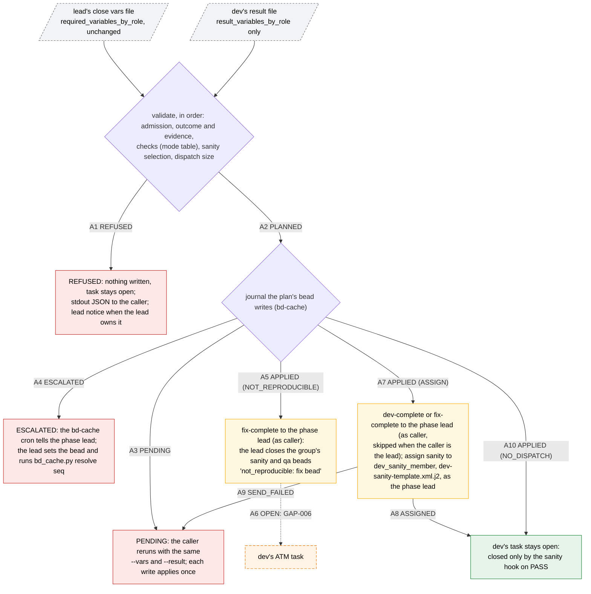
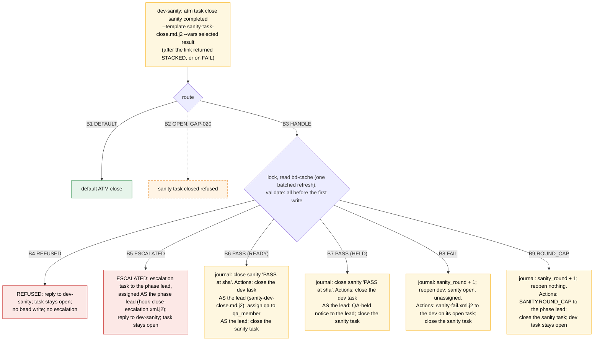
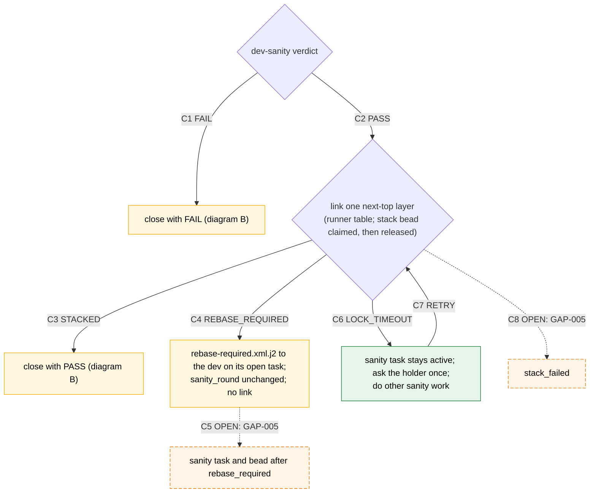
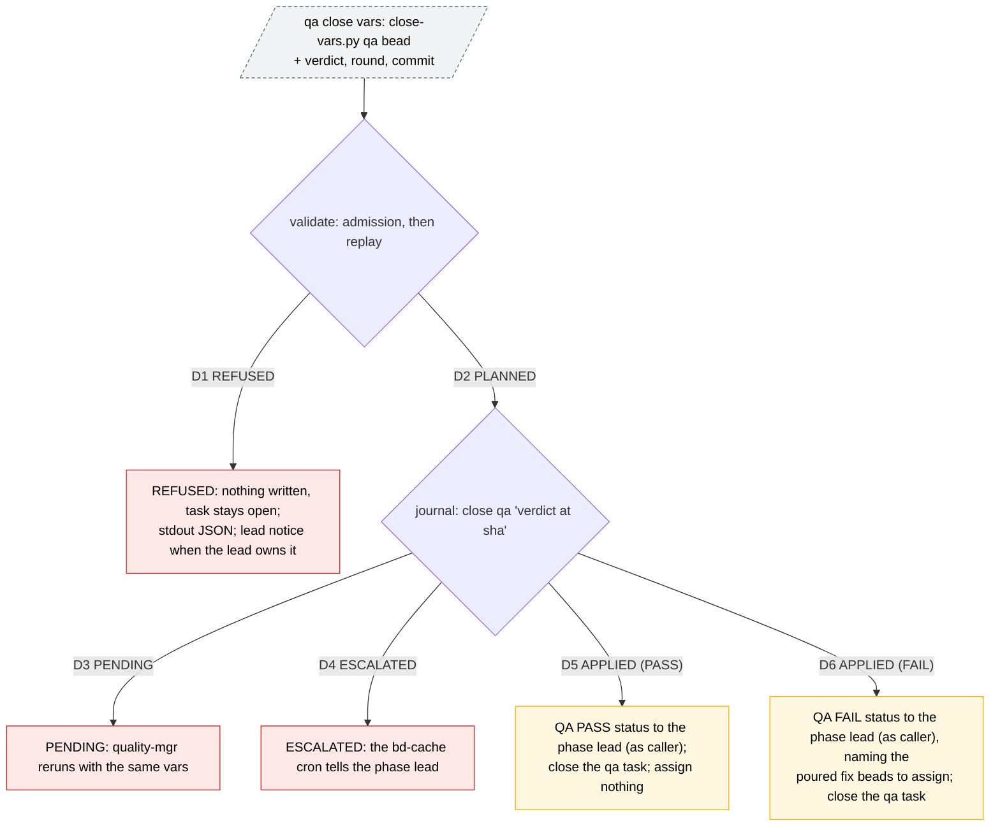
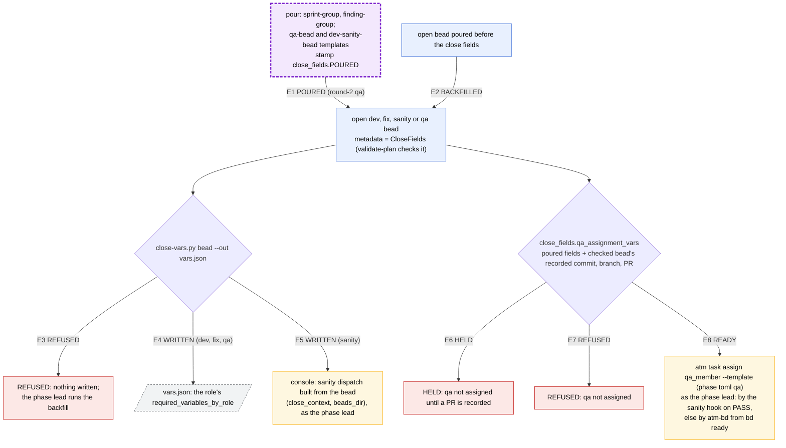

# Task close: close script, sanity hook and close vars

> **Phase bm TARGET draft, v2.** This is the close machine as it must be
> after the refactor, not as v0.19.8 runs it. Sources: the gap list
> (`scratchpad/bm/gap-list.md`, including the Rand rulings of 2026-10-28),
> the failure-message audit (`scratchpad/bm/failure-messages-audit.md`) and
> the locked anchors in atm-core `develop` (`phase-bj`, `phase-bk`,
> `phase-bh`). Where an anchor and the v0.19.8 doc disagree, the anchor
> governs.
>
> v2 collapses every set of outcomes that ends in the same state into one
> edge (REFUSED, ESCALATED, PENDING). Each diagram has three tables:
>
> - **Transitions:** one row per edge. One row is one match arm and one table test.
> - **Sub-arms:** for an enum that only parameterises an edge, such as the
>   check mode or the escalation delivery.
> - **Errors:** one row per error id that a collapsed edge covers, with the
>   exact text the code must emit. One row is one table test that asserts
>   the code, the receiver and the text.
>
> Edges labelled `OPEN` are undecided and are listed at the end. Unlabelled
> arrows show data flow and are not match arms.

A task closes through one of two paths. Both write beads only through the
bd-cache journal (bd-cache.md):

| Role | Close | Run by |
| --- | --- | --- |
| dev, fix | `atm-task-close.py --role dev\|fix --vars <lead's close vars> --result <dev's result>` | the dev |
| sanity | `atm task close <sanity> completed --template sanity-task-close.md.j2 --vars <selected result>`, handled by the ATM `task.close` hook `sanity_task_close_hook.py` | dev-sanity; the hook runs in the daemon |
| qa | `atm-task-close.py --role qa --vars <close vars>`, after the fix groups are poured | quality-mgr |

The daemon hook is the **only** sanity close path (GAP-007 (a)). It has no
legacy mode, `atm-task-close.py` has no `sanity` role, and `sanity-close-vars`
and `sanity_close_mode` are deleted. The hook is registered per phase from the
primary checkout (`atm hook register task.close --phase <x> --cwd . --module
... --custom '{"task_prefix": ..., "sanity_agents": [...]}'`) and disabled
with `atm hook disable --phase <x> task.close`. Its timeout is 2.5 s (bk:ANC-011,
ANC-012).

**Identities and placeholders** used in messages:

| placeholder | meaning |
| --- | --- |
| `{lead}` | the phase lead: `lead` in `.atm-bd/phase-<x>.toml` (bj:ANC-051, bh:ANC-023) |
| `{caller}` | the identity running the close |
| `{task}`, `{bead}` | the closing task and its bead (the same id) |
| `{vars}`, `{result}`, `{role}` | the close's `--vars` path, `--result` path and `--role` |
| `{phase}` | the phase id `<x>` |

Close-script and hook notices are sent as the caller (GAP-023 (b)). Every
`atm task assign` and every task close done for another role runs as the
phase lead, and so does the hook's escalation assign (GAP-039).

**Delivery terms** used in the error tables:

- **stdout JSON**: `{"err":{"code","message","fix"}}` on the caller's
  stdout and stderr, exit 1 (close script). For close-vars.py it is
  `{"ok":false,"error":{...}}`, exit 2. For the hook it is the `refused`
  reply's `message`, which ATM returns to the caller as the command error
  (bk:ANC-004).
- **lead notice**: the close script also sends the same error JSON to
  `{lead}` with `atm send {lead} --stdin`, as the caller. It is sent for
  every refusal whose owner is the phase lead (audit structural finding 1).
  The `fix` text then addresses both: what `{lead}` runs, and that
  `{caller}` waits.
- **escalation**: the hook's tracked task `<task>.close-error-<id>`,
  assigned to `{lead}` as the phase lead with `hook-close-escalation.xml.j2`.
  Its `recovery` field is the exact message in the row, not the fixed
  "Phase lead: correct..." text (audit structural finding 2).

Each escalation `recovery` ends with the **retry tail**: "Then tell
{caller} to rerun `atm task close {task} completed --template
sanity-task-close.md.j2 --vars <same file>`; only {caller} may rerun it."
The tail exists because only the assigned sanity agent may close the sanity
task, so the lead cannot retry the close itself.

## A. Dev or fix close

The dev never types the derived fields and never adds fields to the lead's
file. The sanity dispatch is the lead's vars file plus the dev's result file
plus the derived values (commit = HEAD, generated_at, the PR identity of the
check mode) (bj:ANC-058 as amended by GAP-008 (a)). It carries
`close_context` and `beads_dir`, and no `sanity_close_mode`. When a close dies
after the bead close and before the assign, atm-bd assigns the sanity bead
from `bd ready` (bj:ANC-052, ANC-061), building the same dispatch from the
bead (GAP-012). `STACK.TOP` is deleted (GAP-036). Refused and cancelled dev
closes bypass the script (`atm task close <id> refused|cancelled`, TCH.11).

**Transitions**

| edge | guard | outcome | effects | governing |
| --- | --- | --- | --- | --- |
| A1 | any validation in the A error table fails | REFUSED | nothing written; stdout JSON; lead notice when the row's owner is the phase lead | bj:ANC-058, ANC-059, AGR-16, GAP-014, GAP-015 |
| A2 | validation passed; the close plan is chosen (plan table) | PLANNED | journal the plan's writes | bj:ANC-052, ANC-061, GAP-025, GAP-027, GAP-032 |
| A3 | a journaled write is not yet applied, or bd-cache failed transiently | PENDING | journaled once by idempotency key; the bd-cache cron also applies it within a tick | AGR-17 |
| A4 | the drain gave up on the write | ESCALATED | the cron sends `escalation_text` to the phase lead | AGR-17 |
| A5 | applied, plan NOT_REPRODUCIBLE | APPLIED | fix bead closed "not reproducible: `<file:line>`" with its own `metadata.branch` and `metadata.commit` kept; fix-complete to the phase lead as caller, with the hand-close command (A error table); **no sanity task, no stack layer** | GAP-006/041 ruling, GAP-023 (b) |
| A6 | after A5 | OPEN: GAP-006 | who closes the dev's ATM task when no sanity hook will run | bj:ANC-055 |
| A7 | applied, plan ASSIGN | APPLIED | the checked bead records commit, branch, pr_number, pr_url and pr_base and is closed; then report and assign (ASG) | bj:ANC-051, ANC-052, GAP-001, GAP-023 (b), GAP-025 |
| A8 | the report and the assign succeeded | ASSIGNED | `atm task assign {dev_sanity_member} --task-id <sanity> --template dev-sanity-template.xml.j2` as the phase lead; **dev task not closed** | bj:ANC-052, ANC-055 |
| A9 | `atm send` or `atm task assign` failed after the bead close | SEND_FAILED | bead stays closed; a rerun with the same vars re-selects ASSIGN and assigns once; else atm-bd assigns from `bd ready` | bj:ANC-052, ANC-061 |
| A10 | applied, plan NO_DISPATCH | APPLIED | no report, no assign; dev task not closed | bj:ANC-055, ANC-061, GAP-025 |

**Sub-arms: close plan (A2)**

| plan | guard | writes |
| --- | --- | --- |
| NOT_REPRODUCIBLE | role fix, `outcome = not_reproducible`, evidence cited; git, PR and stack checks skipped | close the fix bead; branch and commit not written |
| ASSIGN | (no open sanity assignment, or an open one with a changed sha) and (sanity bead open or sanity task not terminal); dispatch rendered within the ATM request limit | record and close the checked bead |
| NO_DISPATCH | an open sanity assignment at the same sha (ALREADY_ASSIGNED), or sanity task terminal, bead closed, same sha (REPLAY_DONE) | record and close the checked bead (a replay writes nothing twice) |

**Sub-arms: check mode (A2, A1)**

| mode | trigger | checks run | PR identity, `rebased_onto` | `github` |
| --- | --- | --- | --- | --- |
| ONLINE | ls-remote, fetch and gh pulls all answered | clean, pushed head on live `origin`, ancestry of the stack top, exactly one open PR | from GitHub; recorded stack top's head | `available` |
| PR_LOOKUP_UNAVAILABLE | git answered; gh failed with a network or rate-limit error (up to 3 attempts; a timeout counts at once) | clean, pushed head and ancestry against the refs just fetched | recorded on the bead, may be empty (GAP-011 (b)) | `unavailable` + `github_error` |
| OFFLINE | ls-remote or fetch failed with a network or rate-limit error (as above) | clean; cached `refs/remotes/origin/*` never trusted (GAP-022 (a), bh:ANC-004); no PR lookup (GAP-030); further checks: OPEN: GAP-022 | recorded on the bead, may be empty (GAP-011 (b)) | `unavailable` + `github_error` |
| SKIP_CHECKS | `--skip-checks` (dev or fix; its `--help` says it needs the phase lead's permission; no template or prompt names it) | clean and pushed head only; no PR or stack check (GAP-015) | recorded on the bead; `origin/<pr_target>` head; ledger not read (GAP-026) | not probed |

Any other git or gh failure (auth, missing repo, bad JSON) is not a mode:
it refuses (GAP-014).

**Errors (A1 REFUSED, A3 PENDING, A4 ESCALATED, A5 and A9 notices)**

Rows are in validation order. "keep" means the v0.19.8 text is FIX and
reaches the right owner.

| error id | edge | condition | owner | delivered to | exact message (fix text) |
| --- | --- | --- | --- | --- | --- |
| ARGS.INVALID (result) | A1 | `--result` absent for dev or fix | dev | stdout JSON | keep: "--result is required for dev and fix" / "Pass the fixer's result file with --result <result-file>." |
| ARGS.INVALID (usage) | A1 | argparse rejects the arguments | caller | stdout JSON | "Supply --role dev\|fix\|qa and --vars <shared-vars.json>." |
| CONFIG.INVALID (timeout) | A1 | `ATM_BD_GATE_TIMEOUT_S` not a positive integer | caller (own env) | stdout JSON | keep: "Unset ATM_BD_GATE_TIMEOUT_S or set it to a positive integer number of seconds, e.g. ATM_BD_GATE_TIMEOUT_S=180." |
| CONFIG.INVALID (repo config) | A1 | the repo config `{path}` is missing or unreadable | phase lead (runs the installer) | stdout JSON + lead notice | "Repo config {path} is unreadable. {lead}: run the atm-bd-orchestration installer for {root} to regenerate {path}, then tell {caller} to rerun. {caller}: do not edit {path}; this error was sent to {lead}; wait for the reply, then rerun with the same --vars and --result." |
| CONFIG.INVALID (dev_sanity_member) | A1 | `dev_sanity_member` empty | phase lead | stdout JSON + lead notice | "dev_sanity_member is empty in {path}. {lead}: set it in the consumer registry and rerun the installer to regenerate {path}, then tell {caller} to rerun. {caller}: this error was sent to {lead}; wait for the reply." |
| CONFIG.INVALID (no lead) | A1 | `.atm-bd/phase-{phase}.toml` has no `lead`, or `.atm.toml` has no `default_team` | team-lead | stdout JSON; the caller forwards it (no lead to notify; OPEN: auto-send) | "`.atm-bd/phase-{phase}.toml` has no lead. {caller}: send this JSON to team-lead with `atm send team-lead --stdin` and stop until team-lead replies." |
| VARS.INVALID (identity) | A1 | `ATM_IDENTITY` unset | caller | stdout JSON | "Export ATM_IDENTITY=<your member name> (and ATM_TEAM), then rerun with the same --vars and --result." |
| VARS.UNKNOWN | A1 | the result file has a field that is not a result field of the role | dev | stdout JSON | keep: "Remove fields that are not {role} result fields from --result." |
| VARS.INVALID (both files) | A1 | a field is in both files | dev | stdout JSON | "Remove {fields} from --result; never edit the lead's vars file." |
| VARS.INVALID (result JSON) | A1 | `--result` is not valid JSON | dev | stdout JSON | keep: "Correct JSON at line {l}, column {c} in {path}." |
| VARS.INVALID (vars JSON) | A1 | `--vars` is not valid JSON | phase lead | stdout JSON + lead notice | "The lead's vars file {vars} is malformed at line {l}, column {c}. {lead}: regenerate it with `close-vars.py {bead} --out {vars}` and tell {caller} the path. {caller}: this error was sent to {lead}; wait for a corrected file." |
| VARS.INVALID (outcome) | A1 | outcome not allowed for the role | dev | stdout JSON | keep: "Set outcome to {allowed} in {path}, then rerun the hook." |
| VARS.INVALID (dev not_reproducible) | A1 | role dev with `not_reproducible` | dev | stdout JSON | "not_reproducible is a fix outcome: set outcome to complete in --result, or ask {lead} with `atm send {lead}` to re-dispatch the work as a fix bead." |
| VARS.INVALID (render, result field) | A1 | strict header render fails on a result field | dev | stdout JSON | "{field} is a result field: add it to --result, then rerun with the same --vars." |
| VARS.INVALID (render, lead field) | A1 | strict header render fails on a field of the lead's vars | phase lead | stdout JSON + lead notice | "{field} is missing or malformed in the lead's vars {vars}. {lead}: regenerate them with `close-vars.py {bead} --out {vars}` and tell {caller} the path. {caller}: this error was sent to {lead}; wait." |
| VARS.INVALID (task id) | A1 | task id ≠ bead id in the lead's vars | phase lead | stdout JSON + lead notice | "The lead's vars give task {task} ≠ bead {bead}. {lead}: regenerate them with `close-vars.py {bead} --out {vars}` and tell {caller} the path. {caller}: this error was sent to {lead}; wait." |
| VARS.MISSING (result field) | A1 | a required result field is absent | dev | stdout JSON | "Add {fields} to --result, then rerun with the same --vars." |
| VARS.MISSING (shared field) | A1 | a required shared variable is absent | phase lead | stdout JSON + lead notice | "{fields} missing from the lead's vars {vars}. {lead}: regenerate them with `close-vars.py {bead} --out {vars}` and tell {caller} the path. {caller}: this error was sent to {lead}; wait." |
| VARS.EMPTY (shared field) | A1 | a required shared variable is blank | phase lead | stdout JSON + lead notice | "{name} is empty in the lead's vars {vars}. {lead}: regenerate them with `close-vars.py {bead} --out {vars}` and tell {caller} the path. {caller}: this error was sent to {lead}; wait." |
| VARS.EMPTY (pr_target) | A1 | `pr_target` empty in the lead's vars | phase lead | stdout JSON + lead notice | "pr_target is empty in the lead's vars {vars}. {lead}: set it to the checked layer's lower-bound branch (`close-vars.py {bead} --out {vars}`) and tell {caller} the path. {caller}: this error was sent to {lead}; wait." |
| VARS.INVALID (no evidence) | A1 | not_reproducible with no `evidence` | dev | stdout JSON | "Set evidence in --result to a repo-relative path:line that shows the absence, then rerun." |
| EVIDENCE.INVALID | A1 | evidence not repo-relative `file:line` inside the worktree, or the line does not exist | dev | stdout JSON | keep: "Supply a repo-relative file:line citation." / "Cite a file inside the assigned worktree." / "Cited line {n} does not exist in {f} ({m} lines)." |
| COMMAND.FAILED (git or gh) | A1 | ls-remote, fetch or gh failed for a reason other than network or rate limit (auth, missing repo) | dev | stdout JSON | "COMMAND.FAILED: `{argv}` failed: {stderr}. Repair credentials or the remote (`gh auth status`, `ssh -T git@github.com`, `git remote -v`), then rerun with the same --vars and --result." |
| COMMAND.FAILED (timeout) | A1 | a bd, atm or git call other than the reachability probe timed out | dev | stdout JSON | keep: "Retry once, or raise ATM_BD_GATE_TIMEOUT_S if the host is loaded, then rerun with the same vars file." |
| COMMAND.FAILED (merge-base) | A1 | the ancestry command failed | dev | stdout JSON | "`git merge-base --is-ancestor origin/{top} HEAD` failed: {stderr}. Run `git fetch origin`, then rerun with the same --vars and --result." |
| COMMAND.INVALID (origin) | A1 | origin names no owner/repo | dev | stdout JSON | "Run `git remote set-url origin https://github.com/<owner>/<repo>.git` in {worktree}, then rerun." |
| COMMAND.INVALID (producer) | A1 | gh, bd or atm returned JSON of the wrong shape | hook maintainer, via the phase lead | stdout JSON + lead notice | "Producer defect in `{producer}`: {field} is not {expected}. {lead}: file an issue on randlee/atm-bd-orchestration with this JSON. {caller}: you cannot repair this; this error was sent to {lead}; wait for the reply." |
| HEAD.DIRTY | A1 | worktree not clean (every mode) | dev | stdout JSON | keep: "Commit or remove worktree changes before retrying." |
| HEAD.NOT_PUSHED | A1 | live `origin/<branch>` ≠ HEAD (ONLINE, PR_LOOKUP_UNAVAILABLE, SKIP_CHECKS) | dev | stdout JSON | keep: "Push this branch and retry." |
| BASE.NOT_ANCESTOR | A1 | HEAD does not descend from the stack top (ONLINE, PR_LOOKUP_UNAVAILABLE) | dev | stdout JSON | keep: "Rebase onto origin/{top}, push, then rerun the hook." |
| PR.NOT_FOUND | A1 | no open PR at HEAD (ONLINE) | dev | stdout JSON | "Open the PR at the pushed head (`gh pr create --base {pr_target} --head {branch}`), then rerun the hook." |
| PR.AMBIGUOUS | A1 | more than one open PR at HEAD (ONLINE) | dev | stdout JSON | keep: "Close the duplicate PRs so exactly one open PR names this branch and pushed head, then rerun the hook." |
| BEAD.NO_SANITY | A1 | the checked bead's sanity bead ≠ vars `sanity_bead`, or none | phase lead | stdout JSON + lead notice | "{bead} has no sanity bead matching sanity_bead {sanity_bead}. {lead}: create or correct the group sanity bead, then tell {caller} to rerun. {caller}: this error was sent to {lead}; wait." |
| BEAD.INVALID | A1 | a bead named in the lead's vars does not exist or is not unique | phase lead | stdout JSON + lead notice | "Bead {id} named in the lead's vars does not exist or is not unique. {lead}: correct the vars with `close-vars.py {bead} --out {vars}` and tell {caller} the path. {caller}: this error was sent to {lead}; wait." |
| BEADS_DIR.INVALID | A1 | `BEADS_DIR` not absolute | dev, then phase lead | stdout JSON | "Set BEADS_DIR to the absolute path that `bd where --json` returns and rerun; if it returns no absolute path, send this JSON to {lead} with `atm send {lead} --stdin` and wait." |
| VARS.EMPTY (commit) | A1 | the derived commit is empty | dev | stdout JSON | "Push a non-empty HEAD, then rerun with the same --vars and --result." |
| VARS.EMPTY (skip, no PR) | A1 | SKIP_CHECKS and the bead records no PR identity (only if GAP-011 rules refuse) | phase lead | stdout JSON + lead notice | "{bead} records no PR and --skip-checks cannot look one up. {lead}: record it with `bd update {bead} --set-metadata pr_number=<n> --set-metadata pr_url=<url>`, then tell {caller} to rerun. {caller}: this error was sent to {lead}; wait." |
| REPLAY.CONFLICT (sha) | A1 | sanity task terminal, sanity bead closed, recorded commit ≠ HEAD | phase lead | stdout JSON + lead notice | "Sanity {sanity} already passed at {old}; HEAD is now {new}. {lead}: decide whether {new} needs a new sanity assignment and assign it with `atm task assign {dev_sanity_member} --task-id {sanity} --template dev-sanity-template.xml.j2 ...`. {caller}: this error was sent to {lead}; stop." |
| REPLAY.CONFLICT (unassigned) | A1 | the task has no assignment event | phase lead | stdout JSON + lead notice | "Task {task} was never assigned. {lead}: run `atm task assign {caller} --task-id {task} ...` with the phase template. {caller}: this error was sent to {lead}; wait." |
| ASSIGNMENT.TOO_LARGE | A1 | the rendered dispatch exceeds the ATM request limit | dev | stdout JSON | keep: "Shorten {field} in --result (pass the stack view with --compact-json, or cite the full view by file path), then rerun with the same vars file; nothing was closed." |
| BD_CACHE.SCHEMA / BD_CACHE.WRONG_DB | A1 | the bd-cache store is from another version or another dolt database | phase lead | stdout JSON + lead notice | "{bd-cache fix verbatim, e.g. 'move {path} aside; it was built from a different dolt database'}. {lead}: apply it. {caller}: this error was sent to {lead}; wait, then rerun with the same --vars and --result." |
| BD_CACHE.TRANSIENT | A3 | bd-cache backend briefly unavailable | dev | stdout JSON | "bd is briefly unavailable; nothing was lost. Rerun with the same --vars and --result." |
| BEADS.WRITE_PENDING | A3 | journal write not yet applied | dev | stdout JSON | keep: "Rerun with the same vars file once bd answers; the journaled write is applied once (the bd-cache cron also applies it within a tick)." |
| COMMAND.FAILED (send) | A9 | `atm send` or `atm task assign` failed after the bead close | dev | stdout JSON | "The bead is closed; the sanity assign failed: {stderr}. Rerun with the same --vars and --result (the assign runs once), or atm-bd assigns it from `bd ready`." |
| BEADS.WRITE_ESCALATED | A4 | the drain gave up | phase lead | stdout JSON + the cron's message to the phase lead | keep: dev: "Ask the phase lead to set {bead} in bd and run `bd_cache.py resolve {seq} --note <what> --actor <lead>`, then rerun with the same vars file."; lead (cron): "...set the intended state with bd, then clear the entry: bd_cache.py resolve {seq} --note <what you did> --actor <you>." |
| (notice) NOT_REPRODUCIBLE | A5 | not_reproducible close applied | phase lead | fix-complete to the phase lead, as caller | "not_reproducible: {fix} at {evidence}. {lead}: close sanity {sanity} and qa {qa} with `bd close {sanity} --reason 'not_reproducible: {fix}'` and `bd close {qa} --reason 'not_reproducible: {fix}'`." |

## B. Sanity close hook

Validation runs in full before the first journal write, and a refusal at
validation writes no bead. A refusal raised inside the execute step, after
some writes are journaled, keeps those writes, and the drain applies them
(GAP-016). The escalation names them in `progress.journaled`, and a retried
close journals nothing twice. The hook returns its ATM actions once the
writes are journaled. A slow or failing bd never holds the task open, and the
bd-cache cron escalates a write the drain cannot apply (bd-cache.md).

A FAIL is never followed by a lead action, a finding bead, a new layer or a
new task (bj:ANC-056, ANC-072, ANC-086; GAP-004). The dev's task is still
open, so the dev fixes, rebases, pushes and runs `atm-task-close.py` again,
which assigns sanity again (plan ASSIGN). The round shown in
`sanity-fail.xml.j2` is `metadata.sanity_round`, and `max_sanity_rounds` comes
from the repository configuration only (GAP-018, GAP-033). The `.bd-repair-`
routing and the doctor's `SANITY_CLOSE.REPAIR_PENDING` are deleted (GAP-037).
A dry run returns the planned actions, or the refusal alone, and journals
nothing.

**Transitions**

| edge | guard | outcome | effects | governing |
| --- | --- | --- | --- | --- |
| B1 | hook ≠ `task.close`; task id lacks `task_prefix`; task id contains `.close-error-`; caller not in `sanity_agents`; or bead lacks `stage:dev-sanity` | DEFAULT | default ATM close | bk:ANC-001, ANC-005 (AGR-11) |
| B2 | close outcome is `refused` (sanity cannot run) | OPEN: GAP-020 | route, sanity-bead state and re-dispatch after a refusal | GAP-020 (a), bj:ANC-086 |
| B3 | phase sanity task, sanity caller, `completed` | HANDLE | take the per-task lock, read, validate | bk:ANC-006 |
| B4 | a validation fails whose owner is the caller (B error table) | REFUSED | refused reply to dev-sanity; no bead write; no escalation | bk:ANC-004, audit B5; extension beyond BUSY: OPEN |
| B5 | a validation fails whose owner is not the caller | ESCALATED | escalation per the delivery sub-arms; refused reply; no bead write | bk:ANC-004, GAP-039 |
| B6 | valid, PASS, the qa resolver returns READY | PASS (READY) | journal close sanity "PASS at `<sha>`"; actions: `task.close` dev task as the phase lead (sanity-dev-close.md.j2), only if not already complete; `task.assign` the qa bead to `qa_member` as the phase lead with the phase toml qa template and resolver vars; `task.close` sanity task | bj:ANC-053, ANC-055, ANC-060, GAP-001, GAP-002, bk:ANC-009 |
| B7 | valid, PASS, the checked bead's `pr_number` is empty (offline first close) | PASS (HELD) | as B6 without the qa assign; QA-held notice to the phase lead as caller; atm-bd assigns qa from `bd ready` once the resolver returns READY | bj:ANC-061, GAP-011 (b) |
| B8 | valid, FAIL, `sanity_round + 1 ≤ max_sanity_rounds` | FAIL | journal `sanity_round + 1` (keyed by assignment, verdict, sha); reopen the dev bead (precondition: dev task assignee); sanity open and unassigned, `blocks` kept; actions: `sanity-fail.xml.j2` to the dev as caller; `task.close` sanity task; dev task untouched | bj:ANC-056, ANC-057, ANC-072, GAP-003, GAP-009, GAP-018, GAP-023 (b) |
| B9 | valid, FAIL, `sanity_round + 1 > max_sanity_rounds` (repo config, default 5) | ROUND_CAP | journal `sanity_round + 1`; reopen nothing; actions: `SANITY.ROUND_CAP` to the phase lead as caller; `task.close` sanity task; dev task stays open | bj:ANC-057, GAP-003, GAP-019 (a), GAP-033 |

**Sub-arms: escalation delivery (B5)**

| arm | guard | effects | governing |
| --- | --- | --- | --- |
| B5a NOTIFIED | the escalation task was assigned now, as the phase lead | journal `error:<id>` notified; reply `refused` | GAP-039, bk:ANC-004 |
| B5b ALREADY_NOTIFIED | the same cause was notified and its escalation task is still open | reply `refused`; nothing sent again. If that task is terminal, the cause recurred: B5a runs again | AGR-12, audit B18 |
| B5c NOTIFY_FAILED | the escalation assign failed, or there is no phase lead (SANITY_CLOSE.CONFIG) | `escalation_error` journaled; doctor reports SANITY_CLOSE.ESCALATION_PENDING; the reply tells dev-sanity to forward the JSON (error table) | bk:ANC-015, audit B10, B19 |
| B5d UNPERSISTABLE | neither journal can persist the refusal | hook prints the error JSON on stdout and exits 1; ATM fails the close with ATM_HOOK_EXIT; the JSON tells dev-sanity to forward it | REQ-BK-ERRORS (AGR-13), audit B20 |

**Sub-arms: drain (B6-B9)**

The drain arm never changes the action set of the verdict edge.

| arm | guard | effects | governing |
| --- | --- | --- | --- |
| STARTED | the plan has writes; drain spawned | actions of the verdict edge | bd-cache.md |
| SPAWN_FAILED | the plan has writes; drain spawn failed | `drain_spawn_error` logged on stderr; the bd-cache cron drains within a tick; same actions (no message: self-healing) | bd-cache.md |
| NO_WRITES | the plan has no writes (a replay) | no drain; same actions | GAP-028 |

**Errors and notices (B4, B5, B5c, B5d, B7, B8, B9)**

Escalation messages are the `recovery` field and end with the retry tail
(see the top of this doc), written below as "+ tail".

| error id | edge | condition | owner | delivered to | exact message |
| --- | --- | --- | --- | --- | --- |
| SANITY_CLOSE.BUSY | B4 | another close holds the task lock | dev-sanity | refused reply | "SANITY_CLOSE.BUSY: another close of {task} is running. dev-sanity: rerun `atm task close {task} completed --template sanity-task-close.md.j2 --vars <same file>` in a few seconds; do not change the vars." |
| SANITY_CLOSE.COMMAND (budget) | B4 | the hook work budget ran out | dev-sanity | refused reply | "SANITY_CLOSE.COMMAND: the hook ran out of time; nothing was written. dev-sanity: rerun `atm task close {task} completed --template sanity-task-close.md.j2 --vars <same file>`." |
| SANITY_CLOSE.INVALID (sanity) | B4 | result fields wrong: no `--template` source; `task_id` ≠ the task; `checked_bead` ≠ `dev_bead`; `reviewer` ≠ `sanity-selected`; no `run_id`; verdict ∉ {PASS, FAIL}; findings malformed; PASS with findings; FAIL without; caller ≠ sanity assignee; PASS with no commit selected and none on the dev bead (GAP-017) | dev-sanity | refused reply | "SANITY_CLOSE.INVALID {field}: {detail}. dev-sanity: correct {field} in {vars_path} and rerun `atm task close {task} completed --template sanity-task-close.md.j2 --vars {vars_path}`." |
| SANITY_CLOSE.LEGACY_VERDICT | B4 | verdict `CANNOT_RUN` | dev-sanity | refused reply | "SANITY_CLOSE.LEGACY_VERDICT: CANNOT_RUN is not a verdict. dev-sanity: set verdict FAIL with findings and rerun the same close, or refuse the task with `atm task close {task} refused`." |
| SANITY_CLOSE.NOT_STACKED | B4 | PASS, and the checked head is not the layer that sanity-stack returned STACKED | dev-sanity | refused reply | "SANITY_CLOSE.NOT_STACKED: {pr} at {sha} is not the stack top. dev-sanity: run `sanity-stack-link --input <stack-input.json>` and close after it returns STACKED." |
| SANITY_CLOSE.INVALID (blocks) | B5 | sanity bead has no `metadata.dev_bead` or no `blocks` edge | phase lead | escalation | "{detail}. {lead}: run `bd dep add {sanity} {dev} --type blocks` (and set metadata.dev_bead={dev} with `bd update {sanity} --set-metadata dev_bead={dev}`)." + tail |
| SANITY_CLOSE.INVALID (checked bead) | B5 | checked bead is not the dev/fix bead or a linked finding | phase lead | escalation | "{checked} is not {sanity}'s dev or fix bead. {lead}: correct metadata.dev_bead on {sanity} with `bd update {sanity} --set-metadata dev_bead=<bead>`, or re-dispatch sanity with the right checked_bead." + tail |
| SANITY_CLOSE.INVALID (dev open) | B5 | PASS while the dev bead is not closed (GAP-034) | phase lead | escalation | "PASS requires {dev} closed; it is {status}. {lead}: have the dev finish `atm-task-close.py` for {dev}, or close it with `bd close {dev}` if its close was applied elsewhere." + tail |
| SANITY_CLOSE.INVALID (assignee) | B5 | no sanity or dev assignment, or dev bead assignee ≠ dev task assignee | phase lead | escalation | "{detail}. {lead}: run `bd update {dev} --assignee {dev_agent}` (or assign the missing task with `atm task assign`)." + tail |
| SANITY_CLOSE.INVALID (prepared) | B5 | the result conflicts with an already prepared close, or task history is missing | phase lead | escalation | "{detail}. {lead}: reconcile: inspect `.atm-bd/sanity-close/journal.sqlite3` key {key}, decide which result stands, and tell {caller} which vars to close with." + tail |
| SANITY_CLOSE.CONFIG | B5 → B5c | the phase toml or its `lead` is unreadable | team-lead | refused reply (no lead to escalate to) | "SANITY_CLOSE.CONFIG: .atm-bd/phase-{phase}.toml has no lead. dev-sanity: send this JSON to team-lead with `atm send team-lead --stdin` and wait." |
| SANITY_CLOSE.COMMAND | B5 | a bd or atm command failed | phase lead | escalation | "`{command}` failed: {stderr}. {lead}: repair {tool}." + tail |
| SANITY_CLOSE.DATA | B5 | a command returned invalid JSON | phase lead | escalation | "Producer `{command}` returned invalid JSON. {lead}: check `bd version` and `atm --version` against the pinned versions; file an issue on randlee/atm-bd-orchestration with this entry." + tail |
| BD_CACHE.\* | B5 | bd-cache unavailable or failed | phase lead | escalation | "bd is unreachable: {detail}. {lead}: restore it (`bd version`, `bd list -n 1 --json`)." + tail |
| ASSIGN_VARS.CONFLICT | B5 | PASS: the checked bead's branch ≠ the qa bead's poured branch | phase lead | escalation | "qa {qa} branch {a} ≠ checked {b}. {lead}: run `bd update {qa} --set-metadata branch={b}`; the rerun close then assigns QA." + tail |
| ASSIGN_VARS.NOT_PLANNED | B5 | PASS: the qa bead lacks poured close fields | phase lead | escalation | "qa {qa} lacks {field}. {lead}: run `close_fields_backfill.py --phase {phase} --apply`; the rerun close then assigns QA." + tail |
| SANITY_CLOSE.INTERNAL | B5 | any other exception in the module | hook maintainer, via the phase lead | escalation | "Hook defect: {Type}: {error}. {lead}: file an issue on randlee/atm-bd-orchestration with this entry; if it repeats, disable the hook with `atm hook disable --phase {phase} task.close`." + tail |
| (delivery) NOTIFY_FAILED | B5c | the escalation assign failed | phase lead | refused reply carrying `escalation_error` | "The escalation to {lead} failed: {escalation_error}. dev-sanity: send this JSON with `atm send {lead} --stdin`, then wait for {lead} to tell you to rerun." |
| (delivery) ATM_HOOK_EXIT | B5d | neither journal can persist the refusal | phase lead | hook stdout JSON (exit 1); ATM_HOOK_EXIT to the caller | "SANITY_CLOSE.INTERNAL: {error}; nothing was persisted. dev-sanity: send this JSON to {lead} with `atm send {lead} --stdin` and wait." |
| (notice) QA held | B7 | PASS; the checked bead records no PR | phase lead | `atm send {lead}` as caller | "Sanity PASS {sanity} at {sha}: QA {qa} is held because {checked} records no PR. {lead}: record it with `bd update {checked} --set-metadata pr_number=<n> --set-metadata pr_url=<url>`; atm-bd then assigns {qa} from `bd ready`." |
| (notice) sanity-fail | B8 | FAIL within the cap | dev | `sanity-fail.xml.j2` to the dev on its open task, as caller | the template's text (round, max, branch, PR, commit, each "N. NOT complete: reason"), plus: "Your task is still open: fix these items, push, and rerun `atm-task-close.py --role {role} --vars <same> --result <new>`." |
| SANITY.ROUND_CAP | B9 | FAIL above `max_sanity_rounds` | phase lead | `atm send {lead}` as caller | "SANITY.ROUND_CAP {sanity} {sha} undone={items}: round {n} > {max}. {lead}: re-scope the bead, reassign it (`atm task assign <dev> --task-id {dev} ...`), or close it." |

## C. Sanity PASS: link, then close

dev-sanity links the checked PR as the new stack top **before** it runs the
sanity close (GAP-005 (a); bj:ANC-065, ANC-066). A FAIL makes no link and
closes at once.

**Transitions**

| edge | guard | outcome | effects | governing |
| --- | --- | --- | --- | --- |
| C1 | selected verdict FAIL | FAIL | no link; run the close (B8/B9) | bj:ANC-056 |
| C2 | selected verdict PASS | PASS | link with the runner of the runner table | bj:ANC-065, ANC-066 |
| C3 | stack bead claimed; PR base = recorded top; head descends from it; layer written (in lean mode or without GraphQL, recorded unlinked, and linked when GraphQL returns) | STACKED | run the PASS close (B6/B7) | bj:ANC-065, ANC-066, ANC-067, ANC-069 |
| C4 | the checked head does not descend from the recorded top | REBASE_REQUIRED | dev-sanity sends `rebase-required.xml.j2` to the dev on the dev's open task, as caller; no `sanity_round` change; no link | bj:ANC-065, ANC-071, GAP-010 |
| C5 | after C4 | OPEN: GAP-005 | whether the sanity task closes, stays active or is refused, and the sanity bead state | bj:ANC-065 |
| C6 | the stack bead claim timed out (default 60 s) | LOCK_TIMEOUT | the link result names the holder, claim time and active task; the sanity task stays active; dev-sanity asks the holder once and does other sanity work; it never refuses, fails the dev or escalates to a person | bj:ANC-068 |
| C7 | after C6, dev-sanity's next pass | RETRY | dev-sanity (only) links again | bj:ANC-068 |
| C8 | the link failed for another reason | OPEN: GAP-005 | owner and route of `stack_failed` once the close comes after the link | bj:ANC-065, ANC-066 |

**Sub-arms: link runner (C2, C7)**

| arm | guard | effects | governing |
| --- | --- | --- | --- |
| INLINE | exactly one sanity task open and no inline failure | dev-sanity links the layer itself | bj:ANC-066 |
| SUBAGENT | more than one sanity task open, or the inline link failed | spawn sanity-stack for exactly one next-top layer, one spawn at a time, in verdict order | bj:ANC-066 |

**Errors and notices (C4, C6, C8)**

| error id | edge | condition | owner | delivered to | exact message |
| --- | --- | --- | --- | --- | --- |
| rebase_required | C4 | the checked head does not descend from the recorded top | dev | `rebase-required.xml.j2` to the dev on its open task, sent by dev-sanity as caller (never to the lead) | keep the template: "Rebase {branch} onto {top.branch} at {top.head}. Push and run the close hook again on the same task. This outcome does not increment sanity_round." |
| lock_timeout | C6 | the stack bead claim timed out | dev-sanity | the link result JSON to dev-sanity (never to the lead) | "The stack bead is held by {holder} since {claimed_at} for {active_task}. dev-sanity: `atm send {holder}` once, do other sanity work, then rerun `sanity-stack-link --input <stack-input.json>`; do not refuse the task or escalate." |
| stack_failed | C8 | another link failure | OPEN: GAP-005 | OPEN: GAP-005 | proposed (audit): "stack_failed for {pr}: {evidence}. Run `sanity-stack-link --input <file>` after fixing {cause}." |

## D. QA close

quality-mgr pours a fix group for each blocking finding, and creates the
important and minor finding beads, before it closes (bj:ANC-070). A QA that
cannot run closes its task `refused` and bypasses the script (GAP-020 (a)).
No close path enforces a QA round cap, and `transitions.py next_transition`
is deleted along with its doc rows (GAP-038 (a)).

**Transitions**

| edge | guard | outcome | effects | governing |
| --- | --- | --- | --- | --- |
| D1 | any validation in the D error table fails | REFUSED | nothing written; stdout JSON; lead notice when the owner is the phase lead | bj:ANC-058, ANC-070, GAP-035 |
| D2 | admitted; qa bead open (FRESH) or closed with the same "verdict at sha" (REPLAY_SAME) | PLANNED | FRESH journals the close; REPLAY_SAME writes nothing new and finishes the remaining actions | bj:ANC-070, AGR-07 |
| D3 | write not yet applied, or bd-cache failed transiently | PENDING | journaled once | AGR-17 |
| D4 | the drain gave up | ESCALATED | the cron tells the phase lead | AGR-17 |
| D5 | applied, verdict PASS | APPLIED | `QA PASS <qa> commit= round=` to the phase lead as caller (unless the qa task is already terminal); close the qa task; assign nothing | bj:ANC-070, GAP-023 (b) |
| D6 | applied, verdict FAIL | APPLIED | as D5 with the FAIL notice; the phase lead assigns the poured fix beads | bj:ANC-060, ANC-070, GAP-023 (b) |

**Errors and notices (D1, D3, D4, D6)**

| error id | edge | condition | owner | delivered to | exact message |
| --- | --- | --- | --- | --- | --- |
| ARGS.INVALID (skip-checks) | D1 | `--skip-checks` given with `--role qa` | quality-mgr | stdout JSON | "ARGS.INVALID: --skip-checks applies only to dev and fix; rerun without it." |
| CONFIG.INVALID | D1 | repo config or phase toml `lead` unreadable | phase lead (team-lead when there is no lead) | stdout JSON + lead notice (no lead: quality-mgr forwards to team-lead) | "{detail}. {lead}: repair it (rerun the atm-bd-orchestration installer for the repo config; set lead in `.atm-bd/phase-{phase}.toml`). quality-mgr: do not edit config; this error was sent to {lead} (with no lead, send it to team-lead with `atm send team-lead --stdin`); wait." |
| VARS.MISSING | D1 | a required variable is absent | quality-mgr, then phase lead | stdout JSON | "{fields} missing. Regenerate with `close-vars.py {qa} --out {vars}`, add verdict, round and commit, and rerun; if the fields are still missing, send this JSON to {lead} with `atm send {lead} --stdin`." |
| VARS.UNKNOWN | D1 | a variable is undeclared | quality-mgr | stdout JSON | keep: "Remove variables no shared template declares." |
| VARS.INVALID (verdict) | D1 | verdict ∉ {PASS, FAIL} | quality-mgr | stdout JSON | "verdict must be PASS or FAIL" / "Supply the selected review verdict." |
| VARS.INVALID (cannot run) | D1 | verdict `CANNOT_RUN` | quality-mgr | stdout JSON | "Run `atm task close {qa} refused --template task-refused.md.j2 --vars <v>`; do not use this script." |
| VARS.INVALID (render, task id) | D1 | strict render fails, or task id ≠ bead id | quality-mgr | stdout JSON | "{field}: {detail}. Regenerate the vars with `close-vars.py {qa} --out {vars}`, add verdict, round and commit, and rerun." |
| VARS.EMPTY | D1 | a required variable is blank | quality-mgr, then phase lead | stdout JSON | as VARS.MISSING, with "{name} is empty." |
| REPLAY.CONFLICT | D1 | qa bead closed with a different "verdict at sha" | quality-mgr, then phase lead | stdout JSON | "{qa} is already closed '{recorded}'. Rerun with those vars, or ask {lead} for a new QA assignment with `atm send {lead}`." |
| BD_CACHE.TRANSIENT | D3 | bd-cache backend briefly unavailable | quality-mgr | stdout JSON | "bd is briefly unavailable; nothing was lost. Rerun with the same --vars." |
| BEADS.WRITE_PENDING | D3 | write not yet applied | quality-mgr | stdout JSON | keep (as A3). |
| BEADS.WRITE_ESCALATED | D4 | the drain gave up | phase lead | stdout JSON + cron message to the phase lead | keep (as A4). |
| (notice) QA FAIL | D6 | applied FAIL | phase lead | `atm send {lead}` as caller | "QA FAIL {qa} commit={c} round={r}. {lead}: assign the poured fix beads from `bd ready` with `atm task assign <dev> --task-id <fix> --template fix-assignment.xml.j2 --vars <v>`." |

## E. Close vars

Every open task bead carries the fields its close needs from the pour, so a
close reads one bead. A sanity close takes its round from
`metadata.sanity_round` on the sanity bead. close-vars.py no longer derives a
sanity round from `started` events, and it prints no close command for a
sanity bead (GAP-018, GAP-031). A QA close adds its own `metadata.round`.

**Transitions**

| edge | guard | outcome | effects | governing |
| --- | --- | --- | --- | --- |
| E1 | a round-2 qa bead is poured for a fix of a fix | POURED | `reviewers_round1` comes from repo config (or the round-1 qa bead), never from the lead identity | GAP-040 |
| E2 | an open bead lacks close fields; `close_fields_backfill.py --phase {phase} --apply` | BACKFILLED | fills missing fields only, journaled; a differing field is reported, never overwritten | close-fields (CH v0.19.8) |
| E3 | a needed field is still missing after one bd re-read | REFUSED | none; never assemble fields from other beads | close-fields (CH v0.19.8) |
| E4 | dev, fix or qa bead with all fields | WRITTEN | the lead's vars file for the dispatch; the dev's result file is separate | bj:ANC-058 amended (GAP-008 (a)), ANC-089, GAP-042 |
| E5 | sanity bead with all fields | WRITTEN | the vars the console uses to assign sanity when `bd ready` lists it with no task | bj:ANC-052, ANC-061, GAP-012 |
| E6 | the checked bead's `pr_number` is empty | HELD | qa not assigned; held until a PR is recorded | GAP-011 (b) |
| E7 | branch conflict, or the qa bead lacks poured close fields | REFUSED | qa not assigned | bj:ANC-053 |
| E8 | all present and consistent | READY | qa assigned as the phase lead with the phase toml qa template: by the sanity hook on PASS (B6), else by atm-bd from `bd ready` | bj:ANC-051, ANC-053, ANC-061, bh:ANC-023 |

**Errors (E3, E6, E7)**

close-vars.py sends no ATM message. Its caller is the lead (dev and fix
vars), quality-mgr (qa vars) or the console (sanity dispatch). When the
caller is not the lead, the message tells it to forward the JSON.

| error id | edge | condition | owner | delivered to | exact message |
| --- | --- | --- | --- | --- | --- |
| CLOSE_VARS.NOT_POURED | E3 | a needed field is missing after one bd re-read | phase lead | stdout JSON; a non-lead caller forwards it | "The pour or backfill did not stamp {id}. {lead}: run `close_fields_backfill.py --phase {phase} --apply`, then rerun `close-vars.py {id} --out {out}`. If you are not {lead}, send this JSON with `atm send {lead} --stdin`; never assemble these fields from other beads." |
| ASSIGN_VARS.NOT_RECORDED | E6 | the checked bead's `pr_number` is empty | phase lead | stdout JSON (and the B7 notice when the hook hits it) | "{id} closed without a PR (offline). {lead}: record it with `bd update {id} --set-metadata pr_number=<n> --set-metadata pr_url=<url>`, then rebuild these vars; for a not_reproducible fix, close {qa} with `bd close {qa} --reason 'not_reproducible: {id}'` instead." |
| ASSIGN_VARS.CONFLICT | E7 | the checked bead's branch ≠ the qa bead's poured branch | phase lead | stdout JSON (escalation when the hook hits it, B5) | "`bd update {qa} --set-metadata {name}={checked value}`, then rebuild the vars." |
| ASSIGN_VARS.NOT_PLANNED | E7 | the qa bead lacks poured close fields | phase lead | stdout JSON (escalation when the hook hits it, B5) | "Run `close_fields_backfill.py --phase {phase} --apply` (round, reviewers_round1); layer is set when sanity-stack links the PR." |

close-vars.py refusals outside these edges keep their v0.19.8 text:
CLOSE_VARS.READ_FAILED, EVENTS_FAILED, NOT_A_TASK_BEAD and CLOSE_VARS.CONFIG
(FIX). ROLE_MISMATCH is VAGUE and needs a command (OPEN below). NOT_STARTED
is deleted with the sanity round derivation (GAP-018).

## OPEN items

| id | edge(s) | undecided |
| --- | --- | --- |
| OPEN: GAP-006 | A6 | After a not_reproducible close, no sanity hook runs, so who closes the dev's ATM task, and as whom? bj:ANC-055 allows no other closer. The audit suggests the script closes it as the phase lead. |
| OPEN: GAP-022 | check mode OFFLINE | With cached refs untrusted, which pushed-head and ancestry checks run offline (for example the stack bead's recorded top sha against local objects), and what each refuses with. |
| OPEN: GAP-011 | VARS.EMPTY (skip, no PR); B7; E6 | Does `--skip-checks` with an empty recorded PR refuse or proceed as the offline close does? After an offline first close, the B7 and E6 messages have the phase lead record the PR (from audit A28): confirm the lead is the recorder, and say when. |
| OPEN: GAP-020 | B2 | When a sanity task closes `refused`: is the hook route pass-through, or a refusal such as SANITY_CLOSE.REFUSE_UNSUPPORTED ("send the blocker to {lead} with `atm send`; do not close the task")? What state is the sanity bead left in, and who re-dispatches? |
| OPEN: GAP-005 | B4 NOT_STACKED; C5; C8 | SANITY_CLOSE.NOT_STACKED: what the hook reads to know the checked head was stacked. The sanity task and bead state after `rebase_required`. The owner, delivery and route of `stack_failed`. |
| OPEN: lead-notice dedup | A1, D1 lead notice | The close script sends a lead notice on each refusal the lead owns. A dev that reruns sends a duplicate each time. Is there a dedup key (code + task + vars digest), and does the notice use a template? |
| OPEN: no-lead fallback | CONFIG.INVALID (no lead), SANITY_CLOSE.CONFIG | When the phase toml names no lead, should the script and the hook send to `team-lead` themselves (audit B10) instead of asking the caller to forward? |
| OPEN: caller-owned escalation | B4 | The audit removes the escalation for BUSY only. This draft also stops escalating SANITY_CLOSE.INVALID (sanity), LEGACY_VERDICT, NOT_STACKED and the budget case, because their owner is the caller. Confirm, or restore the escalation for those. |
| OPEN: round-cap dev notice | B9 | At ROUND_CAP the dev's task stays open with no message, and the dev waits on the lead (bj:ANC-055). Should the dev also get a notice ("round cap reached; wait for {lead}")? |
| OPEN: hook reply visibility | B4, B5c, B5d | The audit assumed that ATM shows the hook's refused `message` to the caller of `atm task close`, and that a hook exiting 1 has its stdout surfaced. If either is false, the B4, B5c and B5d messages reach nobody. Verify in atm-core. |
| OPEN: ROLE_MISMATCH text | close-vars.py | The audit rates its v0.19.8 text VAGUE (no command). Which command fixes it: re-run close-vars.py with the bead's role, or have the lead correct the bead? |

## Gap-list items not placed in this doc

- **GAP-004, GAP-024.** The rewrites of team-lead.md items 23 and 24,
  lifecycle.md, sprint.md and correlation.md are outside this file. This
  file already shows the target behaviour they must match.
- **GAP-021, GAP-043.** Moot. The legacy sanity role and sanity-close-vars
  are deleted (GAP-007 (a)).
- **GAP-029.** Moot. The hook assigns QA (B6), and the console's
  `bd ready` path is the fallback (E8).
- **GAP-041.** Its test (a not_reproducible close records the fix bead's
  own branch and assigns no sanity task) is A5's table test. The
  "locked bm anchor" for not_reproducible does not exist yet.
