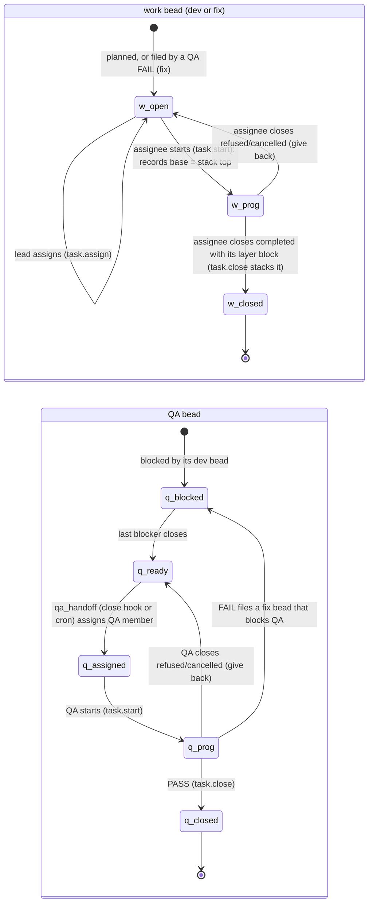
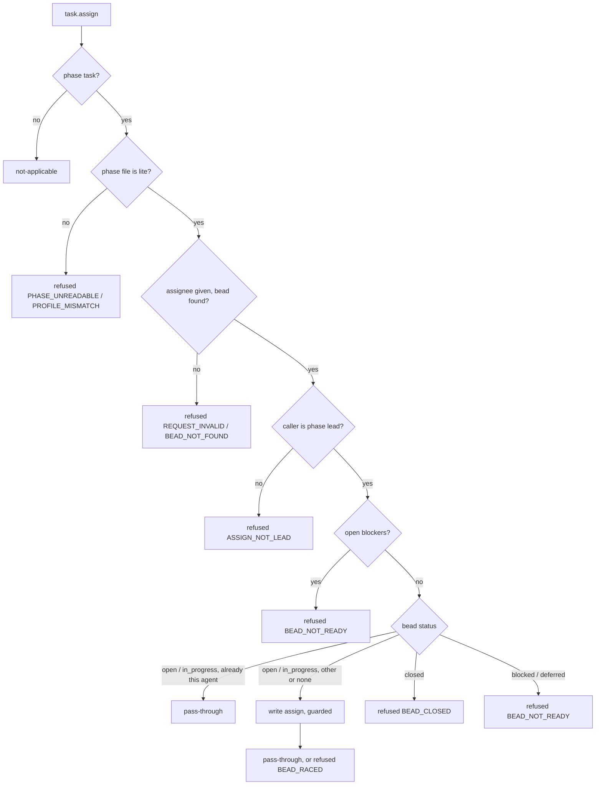
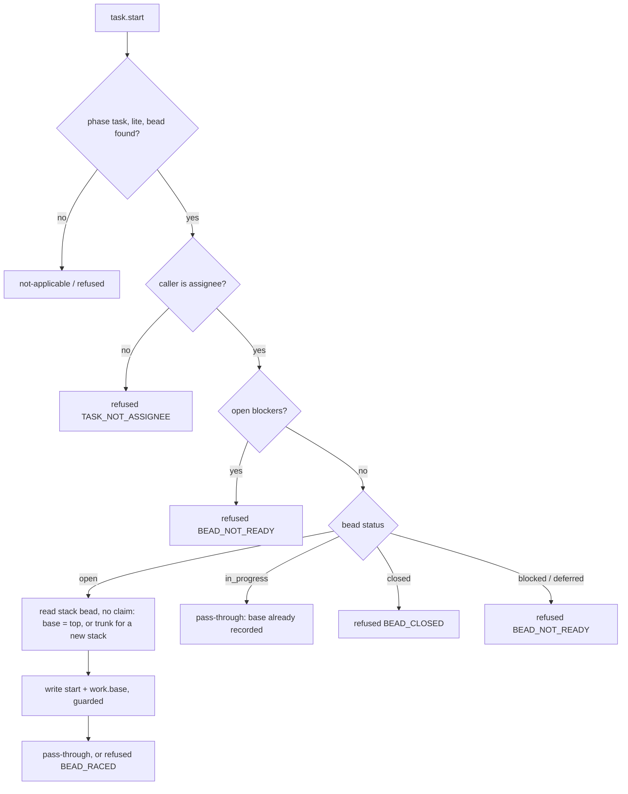
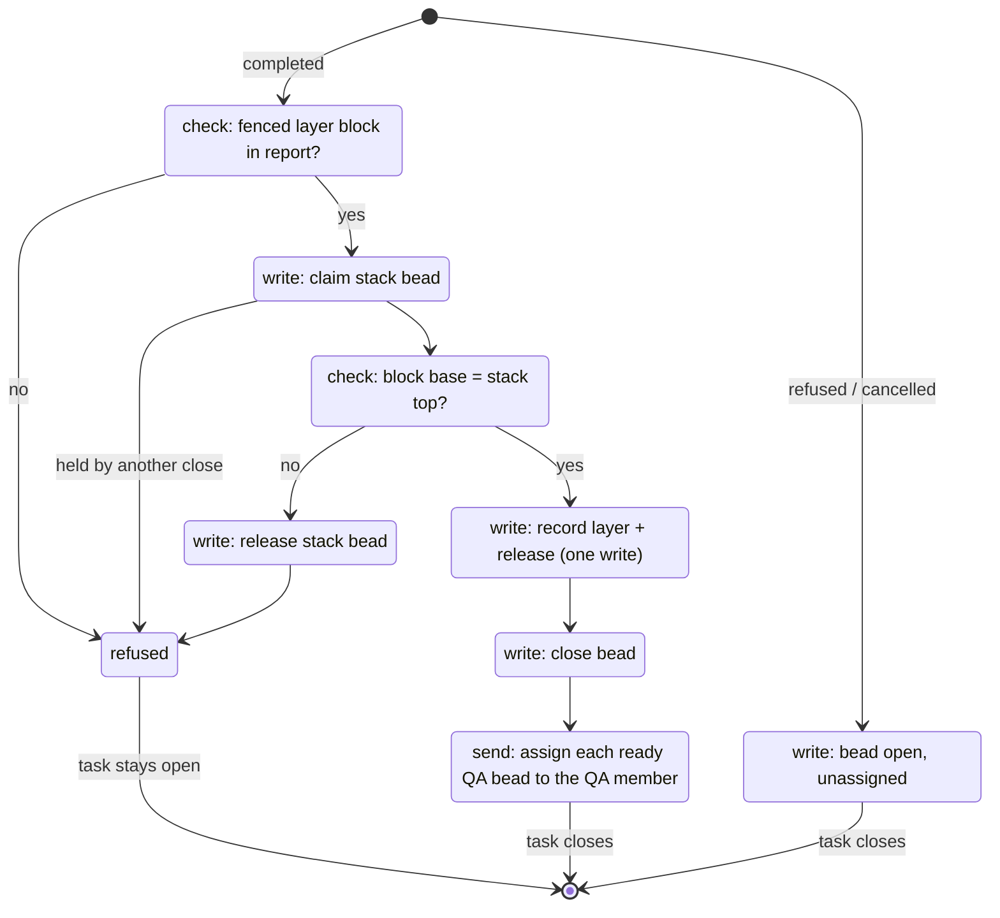
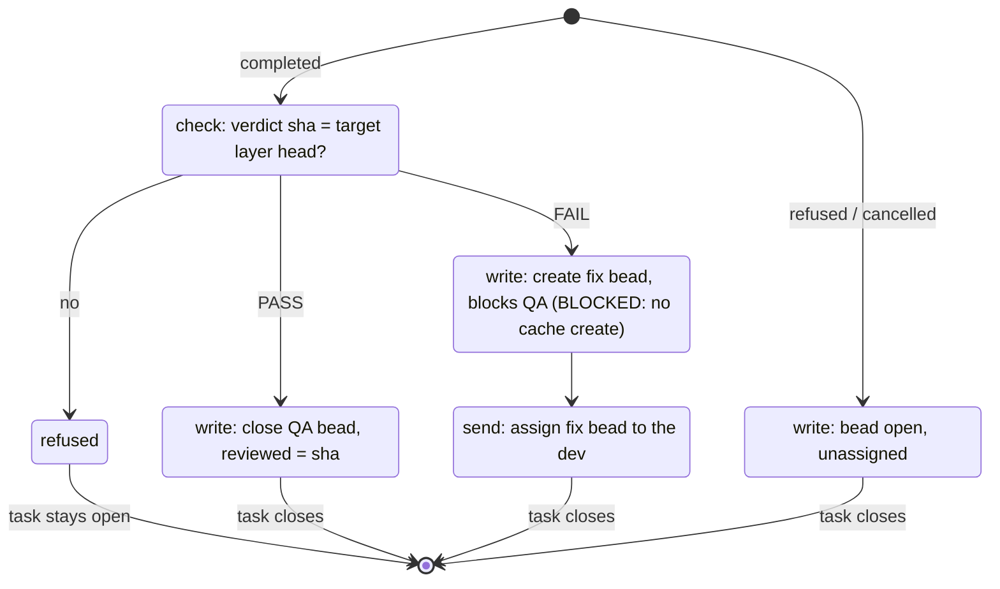

# atm-bd-lite: state transitions

This is the authority for what each atm-bd-lite script does. Each script under
`.atm-bd/atm-bd-lite/scripts/` must match its section here in both directions:
every row is implemented, and every code path appears as a row. Jev checks
this (ANC-053, ANC-054). If the code and this page disagree, that is a defect
in one of them. It is never resolved by editing whichever is more convenient.

All bead reads and writes go through beads-cache (`bd_cache_rs`), never `bd` (ANC-063). Bead states are bd's: `open`, `in_progress`, `blocked`, `deferred` and
`closed`. A refusal is a typed `ErrorId` whose message and fix come from
atm-bd-types. Every reply is recorded by ATM's hook audit log.

## 1. Bead lifecycle (the whole flow)



`q_blocked` and `q_ready` are both bd `open`. "Ready" means `cache.ready` lists
the bead: open, with no open blocker. `q_assigned` is `open` with an assignee.

**The stack bead** holds `trunk` and the ordered `layers`. Only the task.close
hook writes it, between its own claim and release. A new stack has
no layers, so its top is the trunk.

**Who acts:**
- The lead dispatches each dev bead (`atm task assign`) and may set a QA
  bead's `checked_bead` to send QA to a higher layer.
- The close hook and cron dispatch QA.
- The close hook dispatches fixes.

## 2. task.assign (`atm-bd-task-assign-hook.py`)



| bead status | condition | write | reply |
|---|---|---|---|
| open, in_progress | assigned to the agent already | none | pass-through |
| open, in_progress | assigned to someone else, or nobody | `BeadPatch.assign` (guarded) | pass-through; `BEAD_RACED` if the guard fails |
| closed | (none) | none | refused `BEAD_CLOSED` |
| blocked, deferred | (none) | none | refused `BEAD_NOT_READY` |

These checks come before the status match:
1. Not a phase task: not-applicable.
2. Phase file unreadable or not lite: refused.
3. Missing assignee: `REQUEST_INVALID`.
4. Bead missing: `BEAD_NOT_FOUND`.
5. Caller is not the lead: `ASSIGN_NOT_LEAD`.
6. Open blockers: `BEAD_NOT_READY`.

## 3. task.start (`atm-bd-task-start-hook.py`)



| bead status | write | reply |
|---|---|---|
| open | `BeadPatch.start(bead, base = stack top)` (guarded); stack bead only read | pass-through; `BEAD_RACED`; `BEAD_FIELD_MISSING` if work or stack_bead is missing |
| in_progress | none | pass-through |
| closed | none | refused `BEAD_CLOSED` |
| blocked, deferred | none | refused `BEAD_NOT_READY` |

## 4. Stacking (done by the dev, recorded by task.close)

The dev rebases onto the stack top (the trunk on a new stack), pushes and opens the PR with base = top. The dev's close report ends with one fenced JSON block:

```json
{"layer": {"branch": "sprint/bo-12-task-close-hook", "head": "<full sha>", "pr": 1234, "base": "<top branch>"}}
```

The dev runs no stack command and never touches the stack bead. task.close claims the stack bead, checks the block, records the layer and releases (§5, T-CLOSE-02..04).

## 5. task.close (`atm-bd-task-hook.py`)

Input: `atm task close <bead-id> <outcome>` with the report or reason. Everything else is looked up from the bead id.

### Work bead (dev or fix)



### QA bead



The target layer is the layer recorded by the QA bead's closed dev or fix bead, or by the lead's `checked_bead` if set.

### Transitions

| id | bead | when | does | task |
|---|---|---|---|---|
| T-CLOSE-01 | any | refused or cancelled | bead → open, unassigned | closes |
| T-CLOSE-02 | dev, fix | completed, no valid layer block | none | stays open: `LAYER_BLOCK_MISSING` |
| T-CLOSE-03 | dev, fix | stack bead held by another close, or block base ≠ stack top | claim + release, or none | stays open: `STACK_HELD` / `STACK_NOT_STACKED` |
| T-CLOSE-04 | dev, fix | block base = stack top | claim; record layer + release; close bead; assign ready QA beads | closes |
| T-CLOSE-05 | QA | verdict sha is not the target head | none | stays open: `QA_NOT_ON_STACK` |
| T-CLOSE-06 | QA | PASS | close QA, reviewed = sha | closes |
| T-CLOSE-07 | QA | FAIL | **BLOCKED**: needs a fix bead, and beads-cache has no create op | — |

### Errors

Each refusal says what happened, the exact command to run next, and who owns it.

| code | owner | the reader sees |
|---|---|---|
| `LAYER_BLOCK_MISSING` | dev | "Your close report needs one layer block. End it with: ```json {\"layer\": {\"branch\": …, \"head\": …, \"pr\": …, \"base\": …}}```, then close again." |
| `STACK_NOT_STACKED` | dev | "Your layer is based on <base>; the stack top is <top>. Rebase onto <top>, push, update the PR base, fix the block, then close again." |
| `STACK_HELD` | dev | "Another close (<holder>) is recording its layer. Close again." |
| `TASK_NOT_ASSIGNEE` | dev | "<bead> is assigned to <agent>, not you. Close only your own task." |
| `CLOSE_REPORT_EMPTY`, `CLOSE_REASON_EMPTY` | dev | "A close needs a report (or a reason). Run `atm task close <bead> <outcome> --stdin` with it." |
| `QA_NOT_ON_STACK` | dev (QA) | "Your verdict is for <sha>; the layer under review (<branch>) is at <head>. Review <head>, then close again." |
| `QA_NOTHING_TO_REVIEW` | lead | "<qa> has no recorded layer to review. Not yours to fix; the lead has it." |
| `BEAD_NOT_FOUND`, `PHASE_UNREADABLE`, `CACHE_UNAVAILABLE`, `BEAD_RACED`, any other | lead | "Not yours to fix: <what failed>. The lead has it; leave the task open." |

A `lead` refusal reaches the lead through ATM (bo-13: `owner` on the structured refusal).

## 6. Cron (`atm-bd-lite-cron.py --phase P`)

Cron is the safety net for a close whose returned actions never ran. It runs
`qa_handoff` and calls `atm task assign` for each result (actor = lead). It
reports each assign's result. A QA bead already assigned is not listed, so
cron and a close hook racing on the same bead is harmless: the second assign
passes through as a logged same-agent update (#1619).
