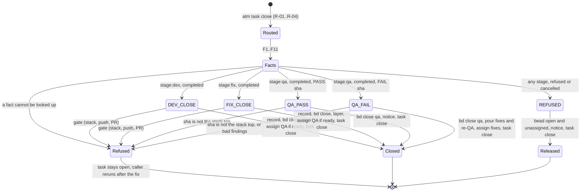
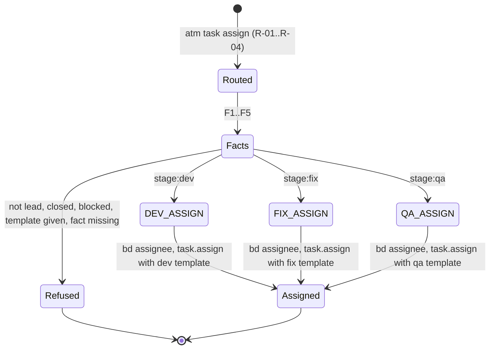
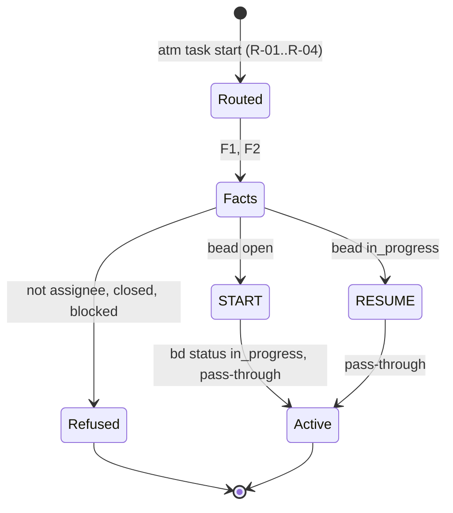

# atm-bd-lite task hooks: task.assign, task.start, task.close

> **Superseded in part (2026-11-01).** The authoritative hook code is `design/lite-code/` (solar PASS, round 12, plus Rand's QA ruling); sprints bo-9..bo-14 carry it. Where this page differs (stack-bead layer writes, per-finding fix beads in D-6, any runner text), the code wins. Current rules: the dev claims the stack bead (bd `--claim`), rebases onto the top (the trunk for a new stack), records its layer and releases in one guarded write, then closes; task.close only verifies the recorded layer. QA reviews the QA bead's `checked_bead` layer (set at handoff, moved by the lead); later layers are ignored. A QA FAIL files one fix bead per QA bead and full sha. A refused or cancelled task close gives the bead back: open, unassigned, and the caller's stack claim released.

> **Phase bo design (2026-11-01).** These are the state-transition
> designs for the three lite ATM task hooks. Jev will judge each hook file against
> its own section (ANC-051..054). The format follows bm v2
> (`plan/phase-bm:docs/plans/phase-bm/design/close-hooks.target.v2.md`). Rows are
> derived from bm v2 A (dev/fix close), C (sanity PASS link, folded into A), D (QA
> close) and E (close vars, replaced here by per-hook Facts tables). B (sanity) is
> dropped: lite has no sanity stage.
>
> Rulings applied (relayed by the coordinator as Rand's, 2026-11-01, binding):
> (1) rows come from A, C (folded into A), D and E, and B is dropped; (2) there is no close-vars file of any kind
> and no progress or state file. The task id is the bead id, and every other fact is
> looked up at hook time; (3) each hook does its own work: no runner (Rand: "so to keep the hook small, you delegate everything to a runner? that doesn't pass the smell test"); (4) no repair, backfill or
> legacy paths: a fact that cannot be looked up refuses with the exact command that
> fixes it.
>
> Every command below was checked against the installed CLI's `--help` on rand-m5
> (atm 1.6.6, bd 1.3.2, gh 2.98.0, git, azure-cli 2.89.1 + azure-devops extension).
> Items that could not be checked are marked **UNVERIFIED**.

## 0. Common contract (all three hooks)

### 0.1 Files

| hook | file (installed under `.claude/skills/atm-bd-lite/scripts/`) | anchor |
| --- | --- | --- |
| task.assign | `atm-bd-task-assign-hook.py` | ANC-048 |
| task.start | `atm-bd-task-start-hook.py` | ANC-049 |
| task.close | `atm-bd-task-hook.py` (name fixed by ANC-002) | ANC-002, ANC-050 |

Each file holds: the interpreter bootstrap (0.6), `TIMEOUT_MS = 2500`, the phase-file
read, its fact lookups (its Facts table), an arm enum, and **exactly one `match`
statement** over the arm enum with no wildcard arm (pyright
`reportMatchNotExhaustive=error`, ANC-003). Each arm runs its own `bd`, `git` and `atm`
commands. There is no runner: the hook does its own work, and its line count is the
real one. A hook file imports no other hook file (ANC-048..050).

atm-bd-core (`.atm-bd/scripts/`) holds only the lookups more than one hook uses: bead
facts (`bd show`), the PR for a branch (`gh pr view <branch>` / `az repos pr list`),
the stack top (git), and one `run(argv, timeout) -> Result` subprocess helper that
tests replace. It holds no profile literal (ANC-044) and has tests on lite and
orchestration-profile inputs (ANC-041, ANC-042). The lite-only `lite_assign_vars.py`
in the lite skill builds assignment template vars for task.assign and task.close.

### 0.2 Input (ADR-068 envelope, fields used)

| field | use |
| --- | --- |
| `hook` | must equal argv[1] |
| `phase` | selects `.atm-bd/phase-<phase>.toml` |
| `team` | team of every returned action |
| `caller.identity` | the actor (`--actor` on every bd write; `as` of the original action) |
| `custom.task_prefix` | routing: tasks without this prefix are not-applicable |
| `request.task_id` | the bead id |
| `request.task_op` | `{"op":"start"}` or `{"op":"close","outcome":"completed\|refused\|cancelled","reason":...}` |
| `request.to.agent` | assignee (task.assign only) |
| `request.message_source` | `{"Inline": "<text>"}` from positional text or `--stdin` (verified: `crates/atm/src/commands/send.rs:575-595`); `{"File":...}` from `--file`; `{"Template":...}` from `--template` |
| `request.dry_run` | the hook runs no write command and returns the planned reply |

The hook runs in the daemon's cleared environment: `PATH`, `HOME`, `ATM_TEAM`,
`ATM_PHASE` and the registered cwd (the primary checkout). There is no `ATM_IDENTITY`
and no `BEADS_DIR` (bk design D-1, `hook_env` in
`crates/atm-daemon-bootstrap/src/hook_runner.rs:92`). bd finds `.beads` from the cwd.
On rand-m5 the daemon's PATH (`/opt/homebrew/bin:...`, from the launchd plist)
resolves `bd`, `git`, `uv`, `az` and the **real** `/opt/homebrew/bin/gh`, not the
`~/.local/bin/gh` wrapper, which routes accounts by cwd. Whether the hook's gh then
uses the right account is **UNVERIFIED** (G-8). No table uses `gh pr list`.

### 0.3 Phase file read (`.atm-bd/phase-<phase>.toml`, relative to the registered cwd)

| key | used by | missing or bad |
| --- | --- | --- |
| `profile` | all (must be `"lite"`, ANC-026) | absent or not `lite` → PROFILE.MISMATCH |
| `lead` | all | PHASE.KEY |
| `integration_branch` | close (stack top of an empty stack), assign | PHASE.KEY |
| `qa_member` | close (QA assign) | PHASE.KEY |
| `provider` (`"github"` \| `"azure"`) | close (PR lookup) | PHASE.KEY |
| `[templates] dev, fix, qa` | assign; close (QA and fix assigns) | PHASE.KEY |

`qa_member` and `provider` are new keys that the lite phase file needs. The
`phase-bo.toml` on `plan/phase-bo-replan` has neither key, and no `profile` key either.

### 0.4 Hook flow (the same in every hook, written inline)

1. Not this hook's event, or `request.task_id` lacks `custom.task_prefix` → reply `not-applicable`.
2. Read the phase file; `profile` ≠ `"lite"` → refused PROFILE.MISMATCH (ANC-026).
3. Look up the facts in table order; a failed lookup refuses with that row's error and fix command (ANC-058).
4. `match` the arm; the arm checks its guards, runs its commands in order (none when
   `dry_run`), and stops at the first failure with COMMAND.FAILED or COMMAND.TIMEOUT.
5. Print the reply.

A write is skipped when the looked-up facts show it already happened (e.g. the bead is
already closed), so a rerun after a timeout finishes the rest. No progress file
exists (ANC-055). `subprocess.TimeoutExpired` becomes COMMAND.TIMEOUT, never an
uncaught exception (ANC-016); any other exception exits non-zero and ATM reports
`ATM_HOOK_EXIT` (fail closed).

### 0.5 Replies and actions

- An action is `{"command", "as", "request"}` (ADR-068 D2). `request` is a copy of
  the original `WriteRequest`, with these fields overwritten in the way the production
  `sanity_task_close_hook.py` builds them (`action()`, line 194): `caller_identity`,
  `caller_team`, `task_id`, `to`, `message_source`, `task_op`; and these removed:
  `task_complete`, `parent_message_id`, `thread_mode`, `placement`,
  `acknowledges_message_id`.
- `task.assign` action: `task_id = <bead>`, `to = {"agent": <member>, "team": <team>}`,
  no `task_op`, `message_source = {"Template": {canonical_template_path,
  canonical_template_root, raw_file_bytes, input_defaults: {}, var_file_values:
  <lite_assign_vars>, explicit_values: {}, environment_values: {}}}`, `as` = `lead`.
- `send` action (a notice): `task_id = null`, `to = {"agent": <lead>}`,
  `message_source = {"Inline": "<text>"}`, `as` = caller. It is emitted only when the
  caller ≠ `lead`, so a one-agent phase (ANC-015) gets no self-notices.
- The original close is always the **last** action. A failing action stops the list
  (ADR-068 D2), so a failure leaves the task open, and a rerun skips the writes that
  already ran.
- Actions run below the hook filter. A `task.assign` returned by the close hook does
  not pass through the task.assign hook, so the close hook runs that bead's assignee
  write itself.
- Refused message format: one-line JSON `{"code": "<ID>", "message": "<text>",
  "fix": "<exact command(s)>"}`, which ATM returns verbatim as `ATM_HOOK_REFUSED`.

### 0.6 Interpreter bootstrap (decided: D-3)

The daemon runs `python3 <module> <hook>`. On rand-m5 that is
`/opt/homebrew/bin/python3`, which does **not** have `atm_bd_types`
(`ModuleNotFoundError`, checked). Proposed: before any `atm_bd_types` import, each
hook file runs `os.execvp("uv", ["uv", "run", "--quiet", "--script", __file__,
*sys.argv[1:]])` once, guarded by an env marker. The PEP 723 header pins
`atm-bd-types==0.2.0` (on PyPI, with abi3 wheels for macOS, Linux and Windows). stdin
is inherited across the exec. Measured: `uv run --with atm-bd-types==0.2.0` takes
0.555 s cold and 0.055 s warm. `doctor` warms the uv cache.

### 0.7 Budget (measured on rand-m5, 2026-11-01)

| call | time |
| --- | --- |
| python3 start | 0.035 s |
| uv re-exec (warm) | 0.055 s |
| `bd show <id> --json` | 0.08 s |
| `git ls-remote origin <2 refs>` | 0.26-0.31 s |
| `gh pr view <ref> --json ...` (the F7 lookup) | 0.46-1.36 s |
| `git merge-base --is-ancestor` | 0.02 s |
| any bd **write** | **UNVERIFIED** (a read-only session cannot measure it) |
| `az repos pr list` | **UNVERIFIED** (no Azure organization available) |

A dev or fix close costs about 1.8 s before its 3-4 bd writes. The hook's budget is
`min(2500, remaining - 500)` (bk §9.7). **The p95 of a full dev close must be measured
before approval.** An `ATM_HOOK_TIMEOUT` leaves the task open, and the rerun skips
the writes that already ran.

---

## A. task.close: `atm-bd-task-hook.py`

### A.1 Event

`atm task close <bead> completed|refused|cancelled "<reason>" ["<report>"]`, or
`--stdin` for the report. There is no `--template` or `--vars` (ruling 2).

| event field | source |
| --- | --- |
| `outcome`, `reason` | `request.task_op` |
| `report` | `request.message_source.Inline` |
| QA verdict | `reason` = `PASS <sha>` or `FAIL <sha>` (`<sha>` = the reviewed stack-top head, 7-40 hex) |
| QA findings (FAIL only) | report lines matching `^(\d+)\. \[(blocking\|important\|minor)\] (.+)$`, numbered 1..N in order |

### A.2 Facts

| fact | lookup command (run by the hook) | when | cannot be looked up |
| --- | --- | --- | --- |
| F1 bead | `bd show <task> --json` → `status`, `assignee`, `labels`, `metadata.{branch, worktree, sprint, stack, stack_bead, qa_bead, checked_bead, round}`, `dependencies[].{id, dependency_type, status}` | always | BEAD.NOT_FOUND; FACT.MISSING per key |
| F2 role | the one label of `stage:dev`, `stage:fix`, `stage:qa` in F1 `labels`; F1 must also carry `phase-<phase>` | always | BEAD.STAGE |
| F3 stack | `bd show <metadata.stack_bead> --json` → `metadata.layers[]` (`{base, branch, head, pr}`) | always | FACT.MISSING (stack_bead) |
| F4 stack top | the last layer whose `branch` ≠ F1 `branch` (`branch`, `head`), else `integration_branch` with head from F6 | always | (derived) |
| F5 head | `git -C <worktree> rev-parse --verify HEAD`, plus `git -C <worktree> status --porcelain` (must print nothing) | dev/fix completed | WORKTREE.MISSING; HEAD.DIRTY |
| F6 remote heads ∥ | `git -C <worktree> ls-remote origin refs/heads/<branch> refs/heads/<top>` | dev/fix completed | COMMAND.FAILED |
| F7 PR ∥ | github: `gh pr view <branch> --json number,url,baseRefName,headRefOid,state`. This is one GraphQL call, once per close and never in a loop; `gh pr list` is banned on this host. The coordinator's field list is extended by `url` (needed for `pr_url`) and `state` (must be `OPEN`, so a merged PR on a reused branch is not taken); all five fields are in `gh pr view --help`; azure: `az repos pr list --source-branch <branch> --status active --detect true --output json` (fields `pullRequestId`, `url`, `targetRefName`, `lastMergeSourceCommit.commitId`: **UNVERIFIED**) → `PrRef{number, url, base, head_sha}` | dev/fix completed | PR.NOT_FOUND (github: exit 1 with "no pull requests found for branch", checked, or `state` ≠ OPEN; azure: 0 rows), PR.AMBIGUOUS (azure: 2 or more rows) |
| F8 ancestry | `git -C <worktree> merge-base --is-ancestor <top head> <F5 head>` (exit 0 yes, 1 no, other = error) | dev/fix completed | GIT.OBJECT_MISSING (exit ≥ 2) |
| F9 QA bead | `bd show <metadata.qa_bead> --json` → `assignee`, `dependencies` | dev/fix completed | FACT.MISSING (qa_bead) |
| F10 checked bead | `bd show <metadata.checked_bead> --json` → `assignee` (the dev) | qa FAIL | FACT.MISSING (checked_bead) |
| F11 poured ids | `bd show <qa>.f1 ... <qa>.fN <qa>.r<round+1> --json` (several ids: found rows only, exit 0; checked) | qa FAIL | (absent = not yet created) |

`<worktree>` is F1 `metadata.worktree`, resolved against the cwd when it is relative.

### A.3 Diagram

### A.4 Transitions (one row per `case` of the single `match` over `atm_bd_types.Transition`)

`classify`: `refused` or `cancelled` → REFUSED. `completed` with stage:dev → DEV_CLOSE,
with stage:fix → FIX_CLOSE, with stage:qa → QA_PASS or QA_FAIL by verdict.

| row | arm | guard (refusals checked in this order, before any command) | commands, in order (`skip_when`) | reply actions, in order | result |
| --- | --- | --- | --- | --- | --- |
| T-CLOSE-01 | DEV_CLOSE | caller = F1 assignee (TASK.NOT_ASSIGNEE); F5 clean; F6 `<branch>` sha = F5 head (HEAD.NOT_PUSHED); F7 one open PR; F7 `head_sha` = F5 head (HEAD.NOT_PUSHED); F7 `base` = F4 top branch (STACK.NOT_STACKED); F8 = 0 (STACK.NOT_ANCESTOR) | 1. `bd update <task> --set-metadata commit=<head> --set-metadata pr_number=<n> --set-metadata pr_url=<url> --set-metadata pr_base=<top> --actor <caller>` (skip: F1 closed); 2. `bd close <task> --reason "<reason> at <head>; PR <url>" --actor <caller>` (skip: F1 closed); 3. `bd update <stack_bead> --metadata '<F3 metadata, layers + {"base":<top>,"branch":<branch>,"head":<head>,"pr":<n>}>' --actor <caller>` (skip: a layer with this branch and head exists); 4. if every `blocks` dependency of F9 other than `<task>` is closed: `bd update <qa_bead> --assignee <qa_member> --actor <lead>` (skip: F9 assignee = qa_member) | `task.assign` qa_bead → qa_member as lead, `[templates].qa` (only when step 4's condition holds); `send` "dev-complete" to lead; original `task.close` | dev task closed; layer recorded; QA assigned when ready |
| T-CLOSE-02 | FIX_CLOSE | as T-CLOSE-01 | as T-CLOSE-01 (the re-QA bead waits for every fix of its round) | as T-CLOSE-01, with notice "fix-complete" | fix task closed; layer recorded; re-QA assigned after the last fix |
| T-CLOSE-03 | QA_PASS | caller = F1 assignee; verdict sha is a prefix of F4 top head (QA.STALE) | 1. `bd close <task> --reason "PASS at <top head>" --actor <caller>` (skip: F1 closed) | `send` "QA PASS: stack <top branch> at <head> is ready to land" to lead; original `task.close` | QA closed; landing is the lead's |
| T-CLOSE-04 | QA_FAIL | caller = F1 assignee; sha check as T-CLOSE-03; 1 ≤ N ≤ 29 findings (QA.FINDINGS; 29 + notice + close ≤ HOOK_ACTIONS_MAX 32) | 1. `bd close <task> --reason "FAIL at <top head>: <N> findings" --actor <caller>` (skip: F1 closed); 2. for i in 1..N: `bd create --id <task>.f<i> --title "<finding i>" --type bug --labels phase-<phase>,stage:fix --assignee <F10 assignee> --metadata '{"role":"fix","phase":..,"sprint":..,"stack":..,"stack_bead":..,"branch":"fix/<sprint>-r<round>-f<i>","worktree":"<worktrees dir>/fix/<sprint>-r<round>-f<i>","qa_bead":"<task>.r<round+1>","checked_bead":"<task>.f<i>","severity":"<sev>","finding_of":"<task>"}' --silent --actor <caller>` (skip: id in F11); 3. `bd create --id <task>.r<round+1> --title "QA round <round+1>: <sprint>" --labels phase-<phase>,stage:qa --deps blocked-by:<task>.f1,...,blocked-by:<task>.f<N> --metadata '{"role":"qa","phase":..,"sprint":..,"stack":..,"stack_bead":..,"round":<round+1>,"checked_bead":"<F1 checked_bead>"}' --silent --actor <caller>` (skip: id in F11) | `task.assign` each `<task>.f<i>` → F10 assignee as lead, `[templates].fix`; `send` "QA FAIL" to lead; original `task.close` | QA closed; N fix beads and one re-QA bead poured and the fixes assigned |
| T-CLOSE-05 | REFUSED | `reason` non-empty (CLOSE.REASON_EMPTY) | 1. `bd update <task> --status open --assignee "" --append-notes "<outcome> by <caller>: <reason>" --actor <caller>` (skip: F1 status open and unassigned) | `send` "<task> <outcome>: <reason>" to lead; original `task.close` | bead back in `bd ready`; the lead decides |

From bm v2: T-CLOSE-01 and -02 cover A7/A8. They also fold in C3: the layer is
recorded and QA is assigned directly, with no sanity step. The old C4 is now
STACK.NOT_ANCESTOR. T-CLOSE-03 and -04 cover D5/D6. The pouring in D's prose moves into
T-CLOSE-04. A1 and D1 are the guards. A5 (not_reproducible) becomes T-CLOSE-05: the dev
closes `refused "not reproducible: <file:line>"`.

### A.5 Errors (refused message; caller = the closing agent)

| id | row(s) | condition | message | fix (given to the caller) |
| --- | --- | --- | --- | --- |
| PHASE.UNREADABLE | R-03 | phase file missing or not TOML | ".atm-bd/phase-{phase}.toml is unreadable: {error}" | "Send this JSON to {lead or team-lead} with `atm send <lead> --stdin`; rerun after it is repaired." |
| PROFILE.MISMATCH | R-04 | `profile` ≠ lite | "phase {phase} has profile {profile}; this is the atm-bd-lite hook" | "{lead}: `atm hook disable --phase {phase} task.close`, then register the hook of the {profile} profile." |
| PHASE.KEY | R-05 | a key from 0.3 is missing | "{key} is missing from .atm-bd/phase-{phase}.toml" | "{lead}: add `{key} = ...` to .atm-bd/phase-{phase}.toml, then rerun." |
| BEAD.NOT_FOUND | F1 | `bd show` exit 1 "no issues found" | "task {task} has no bead" | "Phase-{phase} task ids are bead ids. Check with `bd show {task}`; if this task is not phase work, {lead} re-registers the hook with a narrower task_prefix." |
| BEAD.STAGE | F2 | not exactly one of stage:dev/fix/qa, or no `phase-{phase}` label | "{task} labels {labels} name no single lite stage" | "{lead}: `bd update {task} --set-labels phase-{phase},stage:<dev\|fix\|qa>`." |
| FACT.MISSING | F1, F3, F9, F10 | a metadata key is empty | "{task} metadata lacks {key}" | "{lead}: `bd update {task} --set-metadata {key}=<value>`, then rerun." |
| TASK.NOT_ASSIGNEE | 01-04 | caller ≠ bead assignee | "{task} is assigned to {assignee}, not {caller}" | "Only {assignee} closes {task}. {lead}: reassign with `atm task assign {caller} --task-id {task} \"<note>\"` if intended." |
| WORKTREE.MISSING | F5 | `git -C` fails | "worktree {worktree} for {task} is not a git checkout: {stderr}" | "Create it (`/sc-git-worktree --create {branch} <base>`) or `bd update {task} --set-metadata worktree=<path>`, then rerun." |
| HEAD.DIRTY | 01, 02 | `status --porcelain` printed something | "{worktree} has uncommitted changes" | "Commit or remove them, push, then rerun `atm task close {task} completed \"{reason}\"`." |
| HEAD.NOT_PUSHED | 01, 02 | remote `{branch}` ≠ HEAD, or the PR head ≠ HEAD | "origin/{branch} is {remote}, HEAD is {head}" | "`git -C {worktree} push origin {branch}` (add `--force-with-lease` after a rebase), then rerun." |
| PR.NOT_FOUND | F7 | no open PR from `{branch}` | "no open PR from {branch}" | github: "`gh pr create --base {top} --head {branch}`"; azure: "`az repos pr create --source-branch {branch} --target-branch {top}`"; then rerun. |
| PR.AMBIGUOUS | F7 | azure only: two active PRs | "more than one open PR from {branch}: {numbers}" | "Close all but one, then rerun." |
| STACK.NOT_STACKED | 01, 02 | PR base ≠ stack top (ANC-010) | "PR {n} targets {base}; the stack top is {top}" | github: "`gh pr edit {n} --base {top}`"; azure (`az repos pr update` has no target-branch option, checked): "`az repos pr update --id {n} --status abandoned`, then `az repos pr create --source-branch {branch} --target-branch {top}`"; then rerun. |
| STACK.NOT_ANCESTOR | 01, 02 | top head is not an ancestor of HEAD | "{branch} at {head} does not contain {top} at {top_head}" | "`git -C {worktree} fetch origin {top}`, `git -C {worktree} rebase origin/{top}`, `git -C {worktree} push --force-with-lease origin {branch}`, then rerun." |
| GIT.OBJECT_MISSING | F8 | merge-base exit ≥ 2 | "{top_head} is not in the local object store: {stderr}" | "`git -C {worktree} fetch origin {top}`, then rerun." |
| QA.VERDICT | 03, 04 | reason is not `PASS <sha>` or `FAIL <sha>` | "QA close reason must be `PASS <sha>` or `FAIL <sha>`; got {reason}" | "Rerun `atm task close {task} completed \"PASS {top_head}\"`, or `\"FAIL {top_head}\" --stdin` with numbered findings." |
| QA.STALE | 03, 04 | sha is not the stack top head | "you reviewed {sha}; the stack top is {top} at {top_head}" | "Review {top_head}, then close with that sha." |
| QA.FINDINGS | 04 | 0 or more than 29 parseable findings | "FAIL needs 1-29 findings as `N. [blocking\|important\|minor] <title>`; found {n}" | "Rerun with the report on --stdin in that form (more than 29: merge related findings)." |
| CLOSE.REPORT_FILE | 01-04 | `message_source` is File or Template | "the close report must be inline text" | "Rerun with the report as positional text or `--stdin`; no --file, --template or --vars." |
| CLOSE.REASON_EMPTY | 05 | refused/cancelled with no reason | "a {outcome} close needs a reason" | "Rerun `atm task close {task} {outcome} \"<why>\"`." |
| COMMAND.FAILED | R-07 | a command exits non-zero | "`{argv}` failed (exit {code}): {stderr tail}" | "Fix the cause shown, then rerun the same `atm task close`; completed steps are skipped." |
| COMMAND.TIMEOUT | R-07 | the hook budget ran out | "`{argv}` did not finish within the hook budget" | "Rerun the same `atm task close`; completed steps are skipped." |

### A.6 Verification (Jev)

Inputs: section A of this file plus `atm-bd-task-hook.py` at the PR head. Each
`case Transition.X:` line carries the comment `# T-CLOSE-0n`. Jev checks
(ANC-053) that each row's guards, commands (exact argv and order) and actions are
implemented in that arm. It checks (ANC-054) that each `case` is listed. The
deterministic pair: the number of `case` lines equals 5, and the file has exactly
one `match`. Each A.5 error id occurs in the code once, and each has a table test
asserting its code, message and fix.

---

## B. task.assign: `atm-bd-task-assign-hook.py`

### B.1 Event

`atm task assign <member> --task-id <bead> "<note>"`. ATM's CLI requires a message
source, so `<note>` is always present (checked: `send.rs:595`). The lead passes no
`--template` or `--vars`. The hook renders the phase template from the bead (bm v2
E4/E8, without a vars file).

### B.2 Facts

| fact | lookup command | cannot be looked up |
| --- | --- | --- |
| F1 bead, F2 role | as A.2 F1/F2 | BEAD.NOT_FOUND, BEAD.STAGE, FACT.MISSING |
| F3 stack, F4 stack top | as A.2 F3/F4 (top = `base` var for dev/fix; the review target for QA) | FACT.MISSING |
| F5 checked bead (QA only) | `bd show <metadata.checked_bead> --json` → `metadata.{commit, pr_number, pr_url}` | ASSIGN.NOT_RECORDED |

Readiness: every `blocks` dependency in F1 `dependencies` must be `closed`.

### B.3 Diagram

### B.4 Transitions (single `match` over the hook's `AssignArm` enum)

Guards for every arm, in order: caller = `lead` (ASSIGN.NOT_LEAD);
`message_source` is Inline (ASSIGN.TEMPLATE_GIVEN); F1 not closed (BEAD.CLOSED); no
open `blocks` dependency (BEAD.NOT_READY: "bead {task} is not ready").

| row | arm | extra guard | commands | reply | result |
| --- | --- | --- | --- | --- | --- |
| T-ASSIGN-01 | DEV_ASSIGN | none | 1. `bd update <task> --assignee <member> --if-assignee "<F1 assignee or empty>" --actor <caller>` (skip: F1 assignee = member; exit 13 → ASSIGN.RACED) | handled: original `task.assign` with `message_source` = Template(`[templates].dev`, vars `{task_id, title, phase, sprint, branch, worktree_path, base: <F4 top>, note}`) | bead assigned; task queued |
| T-ASSIGN-02 | FIX_ASSIGN | none | as T-ASSIGN-01 | as T-ASSIGN-01 with `[templates].fix`, vars + `{severity, finding: <F1 title>, finding_of}` | as above |
| T-ASSIGN-03 | QA_ASSIGN | F5 records `commit` and `pr_number` | as T-ASSIGN-01 | as T-ASSIGN-01 with `[templates].qa`, vars `{task_id, phase, sprint, round, stack_top: <F4 branch>, head: <F4 head>, pr_number, pr_url, checked_bead, note}` | as above |

### B.5 Errors

| id | condition | message | fix |
| --- | --- | --- | --- |
| R-03/R-04/PHASE.KEY/BEAD.*/FACT.MISSING | as A.5 | as A.5 | as A.5 |
| ASSIGN.NOT_LEAD | caller ≠ lead | "only {lead} assigns phase-{phase} beads" | "Ask {lead}: `atm send {lead} \"assign {task} to {member}\"`." |
| ASSIGN.TEMPLATE_GIVEN | Template or File source | "the hook renders {role}'s template from the bead" | "Rerun `atm task assign {member} --task-id {task} \"<note>\"` without --template, --vars or --file." |
| BEAD.CLOSED | F1 closed | "bead {task} is closed" | "Nothing to assign; check `bd show {task}`." |
| BEAD.NOT_READY | an open `blocks` dependency | "bead {task} is not ready: blocked by {ids}" | "Assign it after {ids} close (`bd ready` lists it then)." |
| ASSIGN.NOT_RECORDED | QA: F5 lacks commit or pr_number | "{checked} has no recorded commit/PR" | "Close {checked} through `atm task close {checked} completed \"<reason>\"`, which records them." |
| ASSIGN.RACED | `bd update` exit 13 | "{task} assignee changed during the assign" | "Rerun the same `atm task assign`." |
| COMMAND.FAILED/TIMEOUT | R-07 | as A.5 | as A.5 |

### B.6 Verification

As A.6, with row ids T-ASSIGN-01..03 and 3 `case` lines.

---

## C. task.start: `atm-bd-task-start-hook.py`

### C.1 Event

`atm task start <bead> "<one-line plan>"`. Only `task_id` and `caller.identity`
are used.

### C.2 Facts

| fact | lookup command | cannot be looked up |
| --- | --- | --- |
| F1 bead, F2 role | as A.2 F1/F2 | BEAD.NOT_FOUND, BEAD.STAGE |

### C.3 Diagram

### C.4 Transitions (single `match` over `StartArm`)

Guards in order: caller = F1 assignee (TASK.NOT_ASSIGNEE); F1 not closed
(BEAD.CLOSED); no open `blocks` dependency (BEAD.NOT_READY).

| row | arm | condition | commands | reply | result |
| --- | --- | --- | --- | --- | --- |
| T-START-01 | START | F1 status `open` | 1. `bd update <task> --status in_progress --if-status open --actor <caller>` (exit 13 → START.RACED) | `pass-through` (ATM starts the task and tells the assigner) | bead in_progress; task active |
| T-START-02 | RESUME | F1 status `in_progress` | none | `pass-through` | unchanged bead; ATM decides on the task |

### C.5 Errors

TASK.NOT_ASSIGNEE, BEAD.CLOSED, BEAD.NOT_READY, BEAD.* and COMMAND.* use the texts
in A.5/B.5. START.RACED: "{task} changed status during start" / "Rerun `atm task
start {task} \"<plan>\"`."

### C.6 Verification

As A.6, with T-START-01..02 and 2 `case` lines.

---

## D. Doctor (each file, not a match arm)

`doctor(request)` returns `{"success", "message", "findings"}` (bk §9.10). Findings:
`LITE.PROFILE` (phase file not lite), `LITE.TOOL` (`bd`, `git`, or the `provider`
CLI missing on PATH), `LITE.TYPES` (`uv run` cannot import `atm_bd_types==0.2.0`;
running doctor also warms the uv cache).

## E. Type gaps in atm-bd-types 0.1.1 (closed by atm-bd-types 0.2.0, sprint bo-9)

| needed | 0.1.1 |
| --- | --- |
| `AssignArm {DevAssign, FixAssign, QaAssign}`, `StartArm {Start, Resume}` | absent (`Transition` has only the 5 close members) |
| close `cancelled` outcome | no member; folded into `Transition::Refused` |
| ADR-068 `HookRequest` envelope, `HookReply {Handled, PassThrough, NotApplicable, Refused}`, `HookAction` | absent |
| `Command {argv, skip_when, guard_error}`, `Plan {commands, reply}` | absent |
| `BeadFacts` (metadata keys of A.2 F1), `StackLayer {base, branch, head, pr}` | absent |
| `QaVerdict {Pass, Fail}`, `Severity {Blocking, Important, Minor}`, `Finding {index, severity, title}` | absent |
| `PhaseFile {profile: ProfileName, lead, integration_branch, qa_member, provider, templates}` | absent |
| a stable error id on `Error` (e.g. `HEAD.NOT_PUSHED`) | `Error` has `kind`, `message`, `fix`, `detail` only; `ErrorKind` is too coarse to name the A.5 rows |
| `CloseVars` | present but unused (ruling 2) |
| `PrRef {number, url, base, head_sha}`, `StackGateResult`, `Provider` | sufficient |
| `Profile {Full, Lite}` | must be removed (ANC-061): replaced by `ProfileName(String)`, read from the phase file |

## F. Decisions (fenix, 2026-11-01; Rand: "proceed")

| id | decision |
| --- | --- |
| D-1 (was O-1) | No stack claim. Lite is run by one agent (ANC-015) and each dev works one task at a time, so two closes on one stack do not race. If they ever do, the second close fails the git base check against the moved top and refuses with the rebase command (ANC-058). |
| D-2 (was O-2) | `provider` and `qa_member` are keys in the phase file `.atm-bd/phase-<x>.toml`, next to `profile`. No new file. |
| D-3 (was O-3) | Each hook re-execs once under `uv run --script` with a PEP 723 header pinning `atm-bd-types`. The daemon's `python3` is never modified. |
| D-4 (was O-4) | Lite never runs `gh stack`. A layer is "stacked" when its PR base is the stack top, checked with git alone (ANC-008..010, ANC-021). `StackLayer.linked` is dropped. |
| D-5 (was O-5) | A fix branch is `fix/<sprint>-<slug>`, the same naming CLAUDE.md uses. Its worktree follows the sc-git-worktree layout. |
| D-6 (was O-6) | On QA FAIL, each blocking finding gets one fix bead. Important and minor findings become plain finding beads under the phase root. This matches atm-beads `planning.md`. |
| D-7 (was O-7) | Lite creates no dotted ids. Fix and finding beads use bd-generated ids, with `--parent` set to the QA bead. The parent link replaces the id convention. |

Shared code is atm-bd-core (ANC-013, ANC-020). Its source is `plugins/atm-bd-orchestration/core/` in the atm-bd repo, and it installs once per repository to `.atm-bd/scripts` and `.atm-bd/templates`. All of it is new code that lite uses as soon as it lands (ANC-036, ANC-045). Nothing is moved out of the orchestration skill, and the orchestration skill does not import atm-bd-core yet (ANC-030). Shared types live in the `atm-bd-types` crate (ANC-017).

## G. UNVERIFIED

1. bd write latency, so the dev-close p95 against the 2.5 s cap is unknown (0.7).
2. `az repos pr list` JSON field names and its latency. The az flags themselves are verified.
3. `bd update --assignee ""` clears the assignee. `bd update --metadata '<json>'` replaces rather than merges: the draft writes the full merged object, so both behaviours are safe.
4. `bd show <id1> <id2> --json` when **every** id is missing: one missing id gives exit 1 with error JSON, and a mix returns the found rows with exit 0 (checked).
5. `bd create --id` with dotted ids (moot: D-7 uses no dotted ids).
6. Latency of `gh pr view <branch>` by branch name. By PR number it took 0.46-1.36 s, and the not-found exit 1 was checked.
7. That `atm task close` with no MESSAGE sends the reason as an Inline body. The CLI help says "also the report body when no source is given".
8. The gh account the daemon-run hook uses. The real gh uses its active account, not the wrapper's per-directory routing; on a multi-account host the lookup may hit the wrong account.
