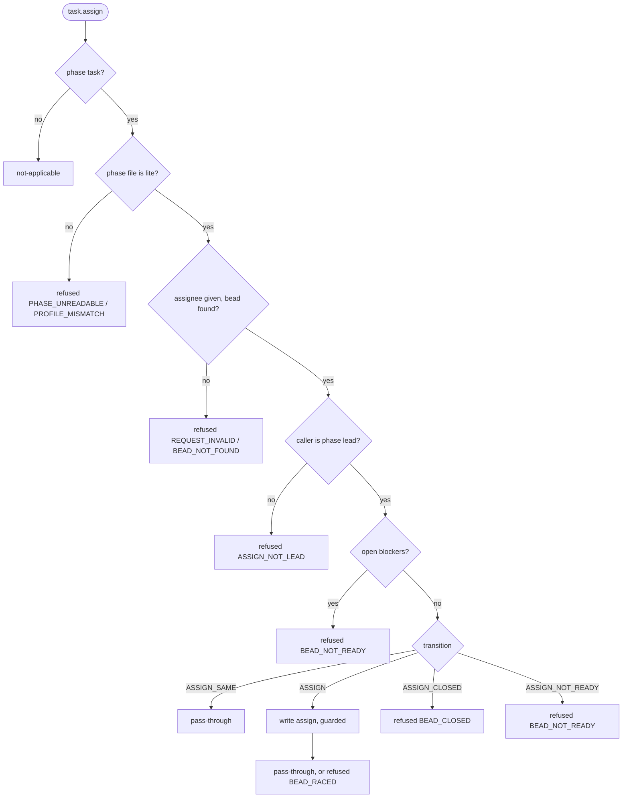

# task.assign — `atm-bd-task-assign-hook.py`

The lead assigns a ready bead. One write: the assignee. Reads: phase file, the bead.

## Transitions (one row per match arm)
| id | transition | status | condition | write | reply |
|---|---|---|---|---|---|
| T-ASSIGN-01 | ASSIGN_SAME | open, in_progress | already assigned to the agent | none | pass-through |
| T-ASSIGN-02 | ASSIGN | open, in_progress | other or no assignee | assign (guarded) | pass-through / BEAD_RACED |
| T-ASSIGN-03 | ASSIGN_CLOSED | closed | | none | refused BEAD_CLOSED |
| T-ASSIGN-04 | ASSIGN_NOT_READY | blocked, deferred | | none | refused BEAD_NOT_READY |

## Facts
| fact | lookup |
|---|---|
| profile, lead | phase file |
| bead status, assignee, open blockers | cache.get(bead) |
| assignee, caller | ATM request |

## Errors
| code | owner | fix |
|---|---|---|
| ASSIGN_NOT_LEAD | lead | "Only the lead (<lead>) assigns. Ask the lead." |
| BEAD_NOT_READY | lead | "<bead> is blocked by <ids> / is <status>. Close the blockers first." |
| BEAD_CLOSED | lead | "<bead> is closed. Nothing to assign." |
| REQUEST_INVALID, BEAD_NOT_FOUND, BEAD_RACED, PHASE_UNREADABLE, PROFILE_MISMATCH, CACHE_UNAVAILABLE | lead | "<what failed>. Retry or fix the phase." |
