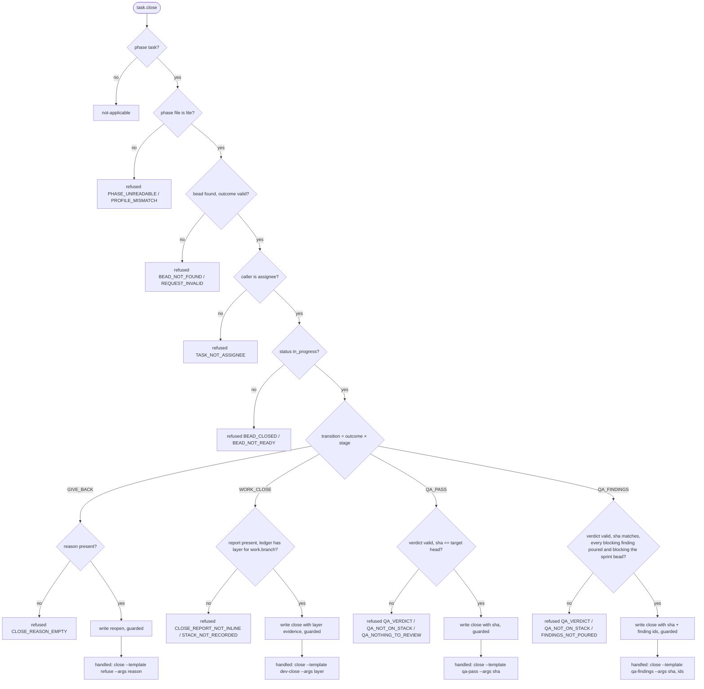

# task.close — `atm-bd-task-hook.py`

Closes the caller's own bead with evidence, or gives it back. One write. Reads: phase file, the bead, the ledger (stack bead), poured finding beads. Writes nothing to the ledger; assigns nothing; creates nothing.

What the agent did before calling close is in its template's fenced blocks (dev: stack block; QA: pour block). The hook verifies the result of those blocks; it never performs them.

## Transitions (one row per match arm)
| id | transition | outcome | stage | hook checks | write | returns |
|---|---|---|---|---|---|---|
| T-CLOSE-01 | GIVE_BACK | refused, cancelled | any | reason present | reopen: open, assignee '' (guarded) | `atm task close --template <refuse> --args reason` |
| T-CLOSE-02 | WORK_CLOSE | completed | dev, fix | report present; ledger has a layer for `work.branch` | close, evidence = layer (branch, head, pr, base) | `atm task close --template <dev-close> --args layer` |
| T-CLOSE-03 | QA_PASS | completed | qa, no findings | verdict sha == target layer head | close, evidence = sha | `atm task close --template <qa-pass> --args sha` |
| T-CLOSE-04 | QA_FINDINGS | completed | qa, findings | sha matches; each blocking finding's poured bead exists and blocks the sprint bead; each non-blocking one blocks the phase bead | close, evidence = sha + finding ids | `atm task close --template <qa-findings> --args sha, ids` |

Target layer (T-CLOSE-03/04): the layer recorded for the QA bead's closed dev/fix blocker, or the lead's `checked_bead` if set. Findings are matched to beads by the id the pour returned, listed in the QA report.

## Facts
| fact | lookup |
|---|---|
| profile, templates | phase file |
| bead status, assignee, stage, work.branch, stack_bead, blockers, checked_bead | cache.get(bead) |
| ledger layers | cache.get(stack_bead) |
| poured finding beads and their blocks | cache.get(id) per finding id in the report |
| outcome, report, reason, verdict | ATM request |

## Errors
| code | owner | fix |
|---|---|---|
| STACK_NOT_RECORDED | dev | "<branch> is not on the ledger. Run the stack block in your task, then close again." |
| CLOSE_REPORT_NOT_INLINE / CLOSE_REASON_EMPTY | dev | "Run `atm task close <bead> <outcome> --stdin` with the report (or reason)." |
| TASK_NOT_ASSIGNEE | dev | "<bead> is assigned to <agent>, not you." |
| BEAD_CLOSED | dev | "<bead> is already closed." |
| BEAD_NOT_READY | dev | "<bead> is <status>; `atm task start` it first." |
| QA_VERDICT | qa | "End the report with one fenced block {\"verdict\": PASS or FINDINGS, \"sha\": …, \"findings\": [ids]}." |
| QA_NOT_ON_STACK | qa | "Your verdict is for <sha>; <branch> is at <head>. Review <head>, then close again." |
| FINDINGS_NOT_POURED | qa | "Findings <ids> are not poured or do not block <sprint>. Run the pour block, then close again." |
| QA_NOTHING_TO_REVIEW, BEAD_NOT_FOUND, BEAD_RACED, PHASE_UNREADABLE, PROFILE_MISMATCH, CACHE_UNAVAILABLE | lead | "Not yours to fix: <what failed>. The lead has it." |
