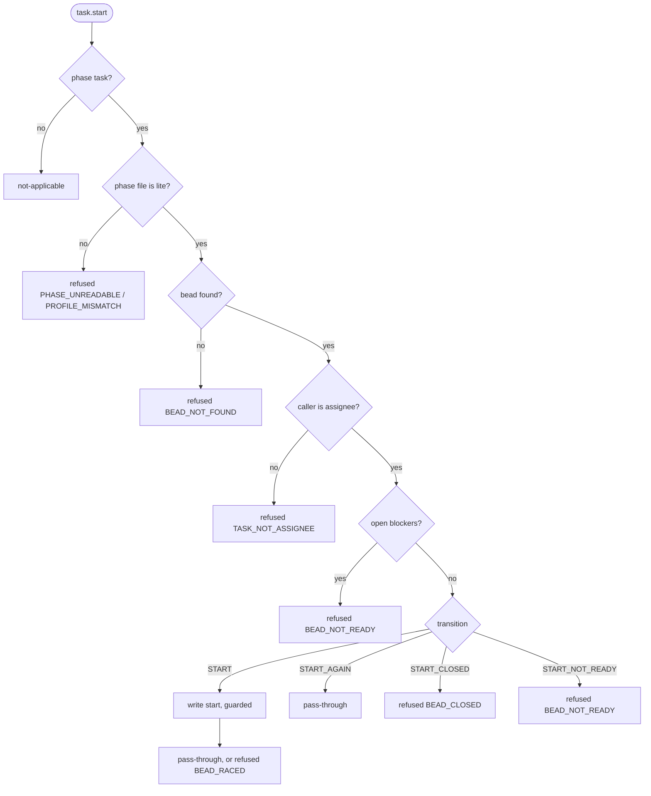

# task.start — `atm-bd-task-start-hook.py`

The assignee starts an unblocked bead. One write: in_progress. Reads: phase file, the bead. Does not read the ledger.

## Transitions (one row per match arm)
| id | transition | status | write | reply |
|---|---|---|---|---|
| T-START-01 | START | open | start (guarded) | pass-through / BEAD_RACED |
| T-START-02 | START_AGAIN | in_progress | none | pass-through |
| T-START-03 | START_CLOSED | closed | none | refused BEAD_CLOSED |
| T-START-04 | START_NOT_READY | blocked, deferred | none | refused BEAD_NOT_READY |

## Facts
| fact | lookup |
|---|---|
| profile | phase file |
| bead status, assignee, open blockers | cache.get(bead) |
| caller | ATM request |

## Errors
| code | owner | fix |
|---|---|---|
| TASK_NOT_ASSIGNEE | dev | "<bead> is assigned to <agent>, not you. Start only your own task." |
| BEAD_NOT_READY | dev | "<bead> is blocked by <ids> / is <status>. Wait for the lead." |
| BEAD_CLOSED | dev | "<bead> is closed. Nothing to start." |
| BEAD_NOT_FOUND, BEAD_RACED, PHASE_UNREADABLE, PROFILE_MISMATCH, CACHE_UNAVAILABLE | lead | "Not yours to fix: <what failed>. The lead has it." |
